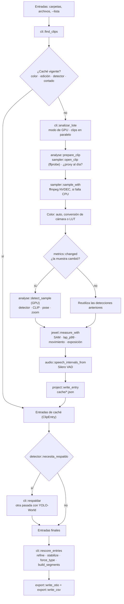

# Núcleo de análisis de CAMCUTS

**Qué es este documento.** La tubería de `crates/camcuts-core` de punta a punta: cómo un clip de cámara se convierte en tramos aprobados y en una línea de tiempo para DaVinci Resolve. Para quien valide el repositorio y para quien lo mantenga después.

**Qué no cubre:**
- Los modelos (ONNX Runtime, DirectML, formas fijas, CUDA): `crates/camcuts-infer`, ver [modelos.md](modelos.md).
- La ventana: `crates/camcuts-gui`, ver [ventana.md](ventana.md).
- La edición Bodas por dentro: [bodas.md](bodas.md) y [empaque/bodas/CLAUDE.md](../empaque/bodas/CLAUDE.md). Aquí solo se dice dónde se desvía (sección 12).
- Los archivos y sus campos: [formatos.md](formatos.md).

**Documentos relacionados:**
- [INTERFACES.md](../INTERFACES.md): el registro de decisiones y mediciones. Aquí se resume y se enlaza; no se repite. Si este documento y el código no coinciden, **manda el código**.
- [GPU_TURNOS.md](../GPU_TURNOS.md): reglas para usar la GPU mientras se desarrolla (el usuario edita video en el mismo equipo).
- [fixtures/README.md](../fixtures/README.md): las salidas de referencia de Python y sus tolerancias.

**Regla de oro.** El núcleo es un port de la app de Python (`camcuts_next/camcuts`). Debe dar **los mismos selects** que Python con el mismo material. Por eso muchas funciones imitan a OpenCV, numpy y Python hasta el último bit (`image.rs`, `pyfmt.rs`). No "simplifiques" esa aritmética sin pasar las pruebas de paridad.

---

## Mapa de archivos

| Archivo | Qué hace |
|---|---|
| `types.rs` | El contrato con los otros crates: `Frame`, `Detection`, `Pose` y el trait `Detector`. |
| `cli.rs` | Línea de comandos y **orquestación**: descubrir clips, decidir qué analizar, lotes en paralelo, respaldo, exportar. |
| `analyse.rs` | El bucle de un clip: muestreo, color, filtro de movimiento, detección, medida, voz y caché. |
| `sampler.rs` | ffprobe y ffmpeg: sondeo, comandos GPU/CPU, rotación, proxies, `-skip_frame noref`, clips cortados, timecode. |
| `color.rs` | Conversiones LOG/HDR a Rec.709, LUT `.cube`, perfil de cámara, XML de Sony. |
| `metrics.rs` | Bordes nítidos, Laplaciano, percentiles, anisotropía, exposición, movimiento de cámara, miniatura. |
| `image.rs` | Aritmética de imagen de 8 bits idéntica a OpenCV 5 (gris, YCrCb, Sobel, `INTER_AREA`). |
| `jewel.rs` | Medida de cada muestra centrada en la joya: grupos, siluetas, nitidez, velocidad. Define `Sample` y `Jewel`. |
| `audio.rs` | Intervalos de voz a partir de las probabilidades de Silero VAD. |
| `scoring.rs` | Criterios (presets), puntuación por muestra, etiquetas estables y construcción de tramos. |
| `export.rs` | OTIO para Resolve y CSV. |
| `project.rs` | Caché por clip, escritura atómica y JSON de la carpeta de resultados. |
| `detector.rs` | Qué detector analiza (propio o YOLO-World), su marca en la caché y la regla del respaldo. |
| `hardware.rs` | Modo de GPU (normal/ligero), VRAM libre, clips en paralelo, prioridad baja, hilos de rayon. |
| `edicion.rs` | Edición del proceso (joyas o bodas) y los nombres que separan sus archivos. |
| `pyfmt.rs` | Formatos de Python: `round`, `repr(float)`, `sum()`, `json.dumps`. |
| `bodas.rs` | La edición Bodas (fuera del alcance de este documento). |

---

## Diagrama del flujo



En texto:
1. Se buscan los clips y se mira si cada uno tiene una caché que sirva.
2. Los que no, se analizan por lotes: ffprobe, ffmpeg, color, detección solo en muestras que cambian, medida, voz. Cada clip deja su caché.
3. Con el detector propio, los clips donde casi nunca sale la joya nítida se analizan otra vez con YOLO-World.
4. Todas las cachés se puntúan con el criterio elegido y salen los tramos.
5. Se escriben el OTIO y el CSV.

**Re-puntuar no vuelve a analizar.** La puntuación trabaja solo sobre las medidas guardadas. Por eso la ventana puede cambiar el criterio en vivo y `--rescore` es instantáneo.

---

## 1. Puntos de entrada

| Binario | Qué hace |
|---|---|
| `camcuts-cli.exe` (`src/bin/camcuts-cli.rs`) | La CLI **sin modelos**. `--rescore` funciona completo. Si hay clips sin analizar, falla con "este binario no tiene modelos". |
| `camcuts.exe --analizar …` | La ventana lanza este proceso hijo (`camcuts-gui/src/analisis.rs`). Llama a `cli::run_con_respaldo` con la fábrica de detectores de `camcuts-infer` y la fábrica del respaldo. |
| `camcuts-bodas.exe --analizar …` | Lo mismo, con la edición fijada en Bodas. |
| `crates/camcuts-infer/examples/analizar.rs` | Igual que `--analizar`, para pruebas. |

**El núcleo no carga modelos.** `camcuts-core` no puede depender de `camcuts-infer` (que depende de él). Por eso `cli::run` recibe una fábrica (`DetectorFactory`) que crea un `Detector` por hilo.

**Lo que pasa la ventana al análisis** (`App::analizar` en `camcuts-gui/src/app.rs`): `--lista <out>\clips.txt --out <out> --no-sheet --preset <criterio> --colores <out>\colores.json`, más `--background`, `--zoom` y `--detector` si tocan.

### Opciones de la CLI (`cli::Args`)

| Opción | Por defecto | Qué hace |
|---|---|---|
| `<inputs>` | — | Clips o carpetas. |
| `--out` | obligatoria | Carpeta de resultados. |
| `--preset` | `joyas` | `joyas`, `social`, `todo` (y `bodas`). Ver sección 8. |
| `--fps` | 4 | Muestras por segundo. |
| `--rescore` | no | Solo re-puntuar las cachés. |
| `--no-sam` | no | Medir sobre la caja, sin siluetas. |
| `--background` | no | Prioridad baja y menos clips en paralelo. |
| `--lista` | — | Archivo con una ruta por línea. |
| `--no-proxy` | no | No escribir el proxy de vista previa. |
| `--colores` | `<out>\colores.json` | Conversión de color por clip. |
| `--modo` | `v1v2` | Forma del OTIO: `aprobados`, `v1v2`, `marcadores`. `--solo-aprobados` = `aprobados`. |
| `--zoom` | no | Segunda mirada a 1920 px en orejas, cuello y muñecas. |
| `--tipo` | — | Filtro de plano: `producto,modelo,hablando`. |
| `--joya` | — | Filtro de joyas (ver la sección "Discrepancias"). |
| `--workers` | según el equipo | Clips en paralelo. **Manda sobre todos los topes**: es para pruebas. |
| `--timeline-fps` | la más común | Frecuencia de la línea de tiempo de Resolve. |
| `--proxy-dir` | — | Carpetas con proxies de RAW (se puede repetir). |
| `--gpu` | `auto` | `auto`, `normal` o `ligero`. |
| `--detector` | propio | `propio` o `world`. |
| `--sin-respaldo` | no | Apaga el respaldo automático. |
| `--motor` | DirectML | Lo aplica `camcuts-infer` (ver INTERFACES.md). |
| `--no-sheet` | — | Se acepta por compatibilidad: Rust no hace hoja de contacto. |

### Variables de entorno que lee el núcleo

| Variable | Efecto |
|---|---|
| `CAMCUTS_EDICION=bodas` | Edición Bodas si el binario no la fijó (`edicion::actual`). |
| `CAMCUTS_DETECTOR` | Detector si no se pasa `--detector`. |
| `CAMCUTS_DECODE=cpu` | Solo decodificación por CPU, sin `-hwaccel`. |
| `CAMCUTS_SALTAR_B=0` | Apaga `-skip_frame noref` (comparaciones). |
| `CAMCUTS_PREFETCH=0` | No arranca el ffmpeg del clip siguiente por adelantado. |
| `CAMCUTS_PROGRESO` | Líneas `progreso<TAB>N<TAB>ruta` por clip (la ventana la pone). |
| `CAMCUTS_PROFILE` | Tiempos por etapa de cada clip en stderr (`analyse::Profile`). |
| `CAMCUTS_LENTO_S` | Otro umbral para la guarda de lentitud (pruebas). |
| `CAMCUTS_DISPOSITIVO=cpu` | Modelos en CPU: no se mira la VRAM, ni modo ligero ni guarda de lentitud. |
| `CAMCUTS_CALIBRATION` | Ruta de la calibración (si no, `models\calibration.json` junto al exe). |
| `RAYON_NUM_THREADS` | Manda sobre `hardware::MEASURE_THREADS`. |

---

## 2. Descubrir clips

**Función:** `cli::find_clips` (CLI) y `datos::reunir_clips` (ventana).

**En la CLI:**
- Entradas = argumentos + líneas de `--lista`. De cada línea se quitan el BOM (el Bloc de notas y PowerShell 5 lo ponen), los espacios y las comillas.
- Una carpeta se lee **sin subcarpetas**, ordenada sin distinguir mayúsculas.
- Vale un archivo si su extensión está en `sampler::FFMPEG_EXT` o `sampler::RAW_EXT` (`sampler::is_video`).
- Se saltan las copias `._C0001.MP4` de macOS (`sampler::es_basura_mac`).

**En la ventana:** recorre con o sin subcarpetas, salta `CAMCUTS`, `CAMCUTS Bodas`, `cache` y `thumbs`, quita duplicados (rutas en minúsculas) y escribe `clips.txt` para `--lista`.

| Constante | Valor |
|---|---|
| `FFMPEG_EXT` | `.mp4 .mov .mxf .m4v .mts .m2ts .avi .mkv .webm .3gp .dng .crm` |
| `RAW_EXT` | `.braw .r3d .nev .ari .arx .mxr .nraw` (se analizan por su proxy) |

---

## 3. ¿Hace falta analizar? (la caché)

**Función:** `cli::run_con_respaldo`.

Para cada clip se busca su caché con `project::cache_file`. Se reutiliza solo si se cumplen **las cuatro** condiciones:

| Condición | Función | Qué mira |
|---|---|---|
| Mismo color | `project::same_color` | El `color` de la caché frente a `colores.json` (sin entrada = `auto`). |
| Misma edición | `edicion::cache_vigente` | La clave `edition`. |
| Mismo detector | `detector::cache_vigente` | Las claves `detector`, `respaldo` y `en_lugar_de`. |
| Archivo igual | `analyse::cortado_vigente` | Solo si la caché dice `cortado`: tamaño y fecha del archivo. |

- Una caché ilegible (cortada) cuenta como clip sin analizar: se avisa y se rehace.
- Con `--rescore` se usan **todas** las cachés de esta edición, sean del detector que sean (`project::read_entries_lenient`).

Los detalles de cada clave están en [formatos.md](formatos.md#1-caché-por-clip-cachejson).

---

## 4. Sondeo con ffprobe

**Funciones:** `sampler::open_clip`, `sampler::probe_json`, `sampler::codec_of`, `sampler::info_from_json`.

**Un solo ffprobe por clip** (`-show_streams -show_format`, ~0.3 s en un 4K de Sony) dice si se puede decodificar y da todos los datos.

**Errores claros, antes de lanzar ffmpeg:**
- "no se puede abrir: …" (no existe, sin permiso).
- "archivo vacío (0 bytes)".
- "archivo dañado o incompleto (…)": la última línea útil de ffprobe (`sampler::short_error`).
- "sin pista de video (¿solo audio?)".
- "códec de video que ffmpeg no decodifica".

**RAW y proxies de cámara.** Si el archivo es RAW, o si ffprobe falla, se busca un proxy con el mismo nombre (`sampler::find_proxy`):
1. Al lado del original.
2. En las subcarpetas `Proxy`, `Proxies`, `proxy`, `proxies`, `ProxyMedia`, `Proxy Media`.
3. En cada `--proxy-dir`, con subcarpetas.

Si hay proxy, se decodifica el proxy (`ClipInfo::decode_path`) pero **el OTIO apunta al original**. Un RAW sin proxy devuelve `None`: sale `[proxy?]` y va a `necesitan_proxy.txt`. Un video normal ilegible sin proxy es un error con su motivo.

**Lo que se lee (`ClipInfo`):**

| Campo | De dónde |
|---|---|
| `width`, `height` | La primera pista de video. **Se intercambian si la rotación es ±90/270** (tamaño mostrado). |
| `rotation` | `side_data_list[].rotation` (matriz de display). |
| `duration` | La de la pista; si no, la del contenedor. |
| `fps` | `r_frame_rate`; si es `0/0`, `avg_frame_rate`. Fracción exacta (`sampler::Fraction`). |
| `start_tc` | Timecode de inicio (sección 10.3). |
| `saltar_b` | Verdadero si el códec es H.264 (sección 5.5). |

---

## 5. Muestreo con ffmpeg

**Funciones:** `sampler::sample_with`, `sampler::attempts`, `sampler::gpu_cmd`, `sampler::cpu_cmd`, `sampler::Decoder`.

ffmpeg corre como subproceso **sin ventana** (`CREATE_NO_WINDOW`) y entrega BGR crudo por una tubería. Un hilo lee los cuadros a un canal de 8 (memoria acotada) y otro vacía stderr (guarda los últimos 4 KB para explicar un fallo).

### 5.1 Tamaños

| Constante | Valor | Por qué |
|---|---|---|
| `LONG_EDGE` | 960 px | Tamaño de análisis de Python: los umbrales y los modelos se ajustaron a él. Dimensiones pares (`scaled_size`). |
| `DETAIL_EDGE` | 1920 px | Copia de detalle solo con `--zoom` (`detail_size`). Nunca se amplía por encima del original. |
| `--fps` | 4 muestras/s | Valor de Python. La muestra `i` está en `t = i / fps`. |

### 5.2 GPU (NVDEC) frente a CPU

`sampler::attempts` devuelve los intentos en orden: **GPU primero, CPU de respaldo**.

**GPU** (`gpu_cmd`), sin proxy:

```text
ffmpeg -v error -y -noautorotate [-display_rotation 0] [-skip_frame noref]
       -hwaccel cuda -hwaccel_output_format cuda -i <fuente>
       -vf fps=4.0,scale_cuda=W:H:format=nv12:interp_algo=lanczos[,transpose_cuda=…],hwdownload,format=nv12,format=bgr24
       -f rawvideo -pix_fmt bgr24 pipe:1
```

- **`fps` va antes de `scale_cuda`**: solo se escalan los cuadros que se analizan. Mismos cuadros, y la GPU ocupada solo por decodificar baja del 25 % al 13 % en un 4K 4:2:2 de Sony.
- Con proxy, en cambio, se escala todo y luego se reparte con `split` (el proxy necesita todos los cuadros).

**CPU** (`cpu_cmd`):

```text
ffmpeg -v error -y -hwaccel auto [-skip_frame noref] -i <fuente>
       -vf fps=4.0,scale=W:H:flags=area -f rawvideo -pix_fmt bgr24 pipe:1
```

- El escalador `area` es **con el que se calibraron los umbrales** de nitidez.
- `CAMCUTS_DECODE=cpu` quita el intento de GPU y también `-hwaccel auto` (que en un equipo NVIDIA usaría NVDEC igual).

**Corrección de nitidez.** El `lanczos` de la GPU mide más nítido que el `area` de la CPU. Cada intento fija su `lap_scale` (`DecodeStats`):

| Constante | Valor | Por qué |
|---|---|---|
| `GPU_LAP_SCALE` | 1/1.103 | Razón medida en dos clips distintos (correlación 0.94–0.98). |
| CPU | 1.0 | Escalador de calibración. |

`lap_p99` se multiplica por `lap_scale`; las varianzas del Laplaciano, por `lap_scale²`. El valor queda en la caché (`lap_scale`, `decode`).

### 5.3 Rotación

- **GPU:** `-noautorotate` y el giro lo hace `transpose_cuda` (`sampler::transpose`): `clock` o `cclock` según el signo de la rotación. Se escala **antes** de girar (menos píxeles).
- **180°** no tiene paso de `transpose_cuda`: no hay intento de GPU y el clip va por CPU.
- **`-display_rotation 0`** en la entrada (solo si hay rotación): sin él, el proxy ya derecho (540×960) heredaba "rotation=90" y los reproductores lo mostraban girado.
- **CPU:** ffmpeg gira solo (autorrotación) y no copia la matriz.

### 5.4 Proxies de vista previa

El análisis puede escribir el proxy **en la misma pasada** que decodifica las muestras.

| Dato | Valor |
|---|---|
| Ruta | `<out>\cache\proxies\<nombre de la caché>.mp4` (`analyse::prepare_clip`) |
| Ajustes | `sampler::PROXY_ARGS`: libx264 `veryfast`, CRF 20, `-g 8`, `-bf 0`, `yuv420p`, sin audio, `+faststart` |
| Tamaño | El de análisis (lado largo 960), todos los cuadros |
| Mientras se escribe | `<nombre>.part.mp4`; se renombra solo si ffmpeg terminó bien **y el archivo no está cortado** |

- **Por qué `veryfast` CRF 20:** el antiguo `ultrafast`/`fastdecode` CRF 28 apagaba el antibloques y CABAC; la piel y los bordes de la joya salían en bloques. Cuesta ~0.41 s de CPU por 10 s de video a 540×960.
- **GOP de 8 sin B:** el visor busca al instante.
- **No se repite** un proxy que `sampler::proxy_vigente` acepta (firma de x264, ver [formatos.md](formatos.md#2-proxies-de-vista-previa)). Así un reanálisis por color o detector no escribe proxy y puede usar `-skip_frame noref`.
- `--no-proxy` no escribe ninguno.
- La ventana crea aparte los proxies que faltan (`TrabajoProxies` en `camcuts-gui/src/analisis.rs`): mismos `PROXY_ARGS`, escalador `area`, un clip a la vez y prioridad baja.

### 5.5 Decodificar solo I/P: `-skip_frame noref`

**Función:** `sampler::saltar_b`.

**Cuándo se usa:** las tres cosas a la vez.
1. El clip es **H.264** (`ClipInfo::saltar_b`).
2. **No se escribe proxy** en esta pasada (ya hay uno al día, o `--no-proxy`).
3. `CAMCUTS_SALTAR_B` no vale `0`.

Se aplica a los comandos de GPU y de CPU. **Los comandos de proxy nunca saltan** (`proxy_commands` llama a `gpu_input` con `false`).

**Qué hace:** ffmpeg no decodifica los cuadros que nadie usa de referencia. En el material de Sony (GOP `I B B P …` de 15 cuadros) decodifica un tercio y va unas 2 veces más rápido. Es justo lo que frena el análisis con el detector propio, que está limitado por NVDEC.

**Consecuencia:** cada muestra sale del cuadro decodificado más cercano (a ≤ 50 ms del instante de siempre). **Un reanálisis no es idéntico bit a bit al primero.** Medido: 257.8 s aprobados frente a 259.0 s, con los mismos tramos por clip.

**Por qué `noref` y no `bidir`** (cambio del 2026-11-06): `bidir` descarta todas las B, también las que x264 (b-pyramid normal, su valor por defecto) deja que un P use de referencia. Esos P salían corruptos sin aviso: 27 de 29 cuadros en un clip de prueba. Con `noref`, los cuadros decodificados son idénticos a una decodificación completa (prueba `robustez::saltar_no_referencia_da_los_mismos_cuadros`). En Sony ahorran lo mismo: 20 s de C9262 en NVDEC, 1.36 s con cualquiera de los dos, 2.5 s sin saltar.

### 5.6 Fallos a mitad, clips cortados y cuelgues

**Si la GPU no da ni un cuadro**, se prueba la CPU desde el principio.

**Si ffmpeg falla a mitad** (sale con error y faltan cuadros), puede ser la GPU y no el archivo. Se prueba el intento siguiente (CPU), que **sigue desde la última muestra entregada** (`entregadas`): no se repiten muestras ya medidas. Desde ahí, las muestras usan el `lap_scale` de la CPU.

**Detección de clip cortado.** ffmpeg suele terminar "bien" aunque falte el final. Por eso se compara con la duración:

| Regla | Efecto |
|---|---|
| Última muestra + 1 s < duración | `DecodeStats::cut_at` = segundo de la última muestra. |
| En la caché | `"cortado": {"hasta", "bytes", "mtime"}` (`analyse::CLAVE_CORTADO`). |
| En la CLI | Aviso en stderr en cada pasada (también desde la caché) y, en la pasada que lo analiza, una línea en `errores.txt`. El análisis de lo que hay **sí vale**. |
| Proxy | No se guarda (el `.part.mp4` se borra): `proxy_vigente` lo aceptaría después aunque estuviera incompleto. |
| Reanálisis | Solo si el archivo cambia de tamaño o de fecha (se volvió a copiar entero). |

**Otros fallos:**

| Constante / caso | Valor | Efecto |
|---|---|---|
| `DECODE_STALL` | 180 s | Sin un cuadro en ese tiempo: se mata ffmpeg y el clip falla ("¿archivo dañado?"). |
| Clip demasiado corto | duración < 0.5 / fps | El filtro `fps` no da ninguna muestra: error que lo dice. |
| Ningún intento da cuadros | — | "ffmpeg no pudo decodificar ningún cuadro (…)", con la última línea de ffmpeg. |

### 5.7 Arranque adelantado

**Funciones:** `sampler::prepare`, `analyse::prepare_clip`, `analyse::analyse_prepared`.

- Cuando el ffmpeg del clip actual entrega su último cuadro (`on_eof`), el hilo ya abre el clip siguiente y arranca su ffmpeg. El arranque (ffprobe, CUDA, NVDEC, primer GOP; ~1–2 s) se solapa con las últimas muestras.
- Solo si quedan clips para los demás hilos (`cola ≥ workers`).
- El ffmpeg preparado se usa solo si su comando es **exactamente** el primer intento. Si no, se lanza otro. Los resultados no cambian.
- El audio se extrae en otro hilo en paralelo con el video (`sampler::audio_16k`).

---

## 6. Color

**Funciones:** `analyse::analyse_profiled` (aplicación), `color::make_converter`, `color::decoding_for`, `color::detect_profile`, `color::sony_xml`.

**Detección y nitidez van sobre el cuadro convertido.** Por eso cambiar la conversión de un clip invalida su caché (sección 3).

### 6.1 Qué conversión se usa

La de `colores.json` (clave: ruta del clip en minúsculas). Sin entrada, `{"id": "auto"}` (`project::auto_color`).

| Id (`color::TRANSFORMS`) | Qué hace |
|---|---|
| `none` | Nada: el cuadro tal como sale del decodificador. |
| `auto` | **No convierte el color.** Estira la luma si el clip se ve plano (ver abajo). |
| `slog3_sgamut3cine`, `slog3_sgamut3` | Sony S-Log3 → Rec.709. |
| `slog2_sgamut` | Sony S-Log2 → Rec.709. |
| `hlg` | HLG / Rec.2020 (Sony HLG, iPhone HDR) → Rec.709. |
| `vlog` | Panasonic V-Log / V-Gamut → Rec.709. |
| `clog3` | Canon C-Log3 / Cinema Gamut → Rec.709. |
| `applelog` | Apple Log → Rec.709. |
| `cube` | Una LUT `.cube` del usuario. |

### 6.2 `auto`: estirar el contraste

- Un cuadro es "plano" (LOG) si `percentil 99.5 − percentil 0.5` de la luma < 150 (`metrics::is_flat`).
- **El LOG es una propiedad de la grabación:** las 4 primeras muestras deciden cada una por sí misma; desde la quinta manda la mayoría de esas 4 (2 o más).
- Si es plano: `metrics::normalize_contrast` estira la luma de 0.5 a 99.5 %, aplica una curva en S suave (35 % coseno + 65 % lineal) y abre el croma ×1.4.
- Cada muestra guarda `log` (verdadero si se estiró o si se aplicó cualquier conversión).

**Importante: el análisis nunca convierte un S-Log3 por su cuenta.** Con `auto`, los umbrales de nitidez se calibraron con el estirado. El perfil de cámara (`detect_profile`) lo usan:
- el visor de la ventana, para ver los colores bien (`motor::conversion_visor`);
- una acción de la ventana que lee el perfil y lo guarda en `colores.json`. Desde ahí el análisis sí aplica la conversión real.

### 6.3 Conversión de cámara (`CameraConverter`)

Todo precalculado, sobre BGR de 8 bits:
1. **Corregir la matriz Y'CbCr** si el decodificador usó otra que la del archivo (3×3 en punto fijo, como `cv2.transform`).
2. **Tabla de entrada** (256 valores por canal): código de cámara → luz lineal, con la curva inversa oficial del fabricante.
3. **Matriz 3×3** de la gama de la cámara a primarios Rec.709 (filas renormalizadas: el neutro sigue neutro).
4. **Tabla de salida** (65 536 niveles): hombro suave y OETF Rec.709.

| Constante | Valor | Por qué |
|---|---|---|
| `SHOULDER_START` | 0.6 | Nivel lineal donde empieza el hombro (blanco 90 % = 0.9). |
| `LINEAR_MAX` | 16.0 | Luz lineal que cubre la tabla (~6.5 pasos sobre el gris); por encima, 255. |

**Cómo decodificó ffmpeg** (`color::decoding_for(ruta, "ffmpeg")`):
- Rango completo si ffprobe dice `color_range = pc` (los Sony), si no limitado.
- Matriz decodificada: la etiquetada (`color_space`), o BT.601 sin etiqueta.
- Matriz real del archivo: `CodingEquations` del XML de Sony; si no, la etiquetada.

### 6.4 Perfil de cámara (`detect_profile`)

En este orden:
1. **XML de Sony** (`CaptureGammaEquation`, `CaptureColorPrimaries`): `s-log3` (+ `cine` → `slog3_sgamut3cine`), `s-log2`, `hlg`; `rec709`, `s-cinetone`, `still`, `cine`… → `none`.
2. **ffprobe:** transferencia `arib-std-b67` → `hlg`; etiquetas con "apple log" → `applelog`; transferencias SDR (`bt709`, `smpte170m`…) → `none`; **PQ (`smpte2084`) no está soportado** → sin perfil.
3. **Apple Log sin marca:** primarios BT.2020 con transferencia sin especificar en `.mov`/`.mp4`, y marca en el átomo `moov`, o ProRes, o etiquetas de Apple/iPhone.

### 6.5 XML de Sony: al lado o incrustado

**Función:** `color::texto_xml_sony`. **La misma fuente para el color y para el drop-frame del timecode** (`sampler::sony_drop_frame`).

1. `<nombre>M01.XML` al lado del clip (manda si existe).
2. Si falta: el `NonRealTimeMeta` que la cámara graba **dentro** del MP4 (`color::xml_incrustado`). Se leen los últimos 256 KB y, si no está, los primeros 256 KB. Solo en `.mp4 .mov .m4v .mxf`, y el texto debe contener `CaptureGammaEquation`. En un A7 IV está a ~700 bytes del final. (Caso real: C9254 no tenía sidecar y su S-Log3 se veía gris.)

### 6.6 LUT `.cube`

**Funciones:** `color::read_cube`, `CubeConverter::new`.
- Admite LUT 1D, 3D, o 1D de preparación + 3D, con `DOMAIN_MIN/MAX` y `LUT_*_INPUT_RANGE`.
- **Rango de entrada:** el que diga la cabecera (`# … full in`, `legal in`, `LUT_IN_VIDEO_RANGE` de Resolve); si no dice nada, `full` si el archivo es de rango completo, si no `legal`.
- Se precalcula una tabla densa 256³ con interpolación trilineal (48 MB). Se guardan las 4 últimas (`CUBE_KEEP`), por ruta, fecha, tamaño y decodificación.

---

## 7. Por cada muestra

**Funciones:** `analyse::analyse_profiled`, `analyse::detect_sample`, `jewel::frame_maps`, `jewel::measure_with`.

### 7.1 Filtro de movimiento: solo lo que cambia va a la GPU

- Cada muestra da una miniatura gris de 96×96 (`metrics::thumb`), **antes** de la conversión de color.
- Si su diferencia media absoluta con la **última muestra que pasó por la GPU** es ≤ 2.5 (`metrics::changed`), es "quieta": reutiliza las detecciones y poses de aquella (`AnalyseStats::reused`, en la caché `reused`).
- Da exactamente lo mismo que el proceso por lotes de Python, porque la decisión solo depende de esa miniatura ancla.
- Se probó una puerta que compensa paneos: ahorraba un 15 % de detecciones pero perdía joyas pequeñas nítidas (`examples/gate_sim.rs`).

**En paralelo:** mientras la GPU detecta, otro hilo calcula las medidas de cuadro entero (`jewel::frame_maps`). El resultado es el mismo que en serie.

### 7.2 Detector: propio frente a YOLO-World

**El trait** (`types.rs`): `detect`, `silhouette`, `pose`, `verify`, `speech`, y con valor por defecto `moments` (Bodas), `kind`, `en_lugar_de` y `prepare`.

**Qué detector** (`detector.rs`, `Args::detector_kind`): `--detector`, si no `CAMCUTS_DETECTOR`, si no **el propio** (por defecto desde el 2026-11-05). Un valor que no se entiende cuenta como no dado. En Bodas siempre YOLO-World (el de boda).

| | YOLO-World ("clásico") | Propio |
|---|---|---|
| Modelo | yolov8x-worldv2 (m en modo ligero) | YOLO11 entrenado con el material de la marca (`camcuts-infer/src/trained.rs`) |
| Etiquetas | Prompts en inglés traducidos (`jewel::JEWEL_PROMPTS`, `PEOPLE_PROMPTS`, `jewel::spanish_label`) | Ya en español |
| Confianza | La del modelo | Reescalada: el umbral de cada clase cae en 0.15; la banda débil va a 0.021–0.149 para que pase por CLIP |
| Por qué | El de Python | En 33 clips de anillos aprobó 2134 s frente a 2083 s de x, con las etiquetas bien, y es más rápido |

**`en_lugar_de`.** Con YOLO-World pedido y poca VRAM (modo ligero), `camcuts-infer` analiza con el propio si está instalado: el mediano confunde las joyas (casi todo "pulsera"). La caché queda con `"detector": "propio", "en_lugar_de": "world"` y vale para los dos detectores. Detalle y mediciones en INTERFACES.md ("Light mode analyses with the own detector").

**Envoltorios.** `analyse::Timed` (perfil de tiempos) reenvía `kind` y `en_lugar_de`. **Cualquier envoltorio nuevo debe reenviarlos**: si no, la caché diría el detector equivocado.

**Prepara los modelos.** El primer clip de cada hilo llama a `Detector::prepare(w, h)` mientras arranca su ffmpeg: los modelos se abren y compilan a la vez.

### 7.3 Lo que hace la GPU con una muestra que cambió

**Función:** `analyse::detect_sample`.

1. **Detección** y descarte de lo que tenga confianza < 0.02.
2. **Verificación CLIP de las débiles** (`analyse::verify_weak`):
   - joyas con 0.02 ≤ conf < `min_conf` que no se solapan (> 0.5) con una fuerte;
   - como mucho 4, las más seguras primero;
   - **una por llamada**: con DirectML un lote de 2–4 recortes tarda ~10 veces más que uno;
   - si CLIP da p ≥ 0.6, la confianza sube a `min_conf` y queda `verified`.
3. **Pose** solo si hay una "persona" con conf ≥ 0.4. Se guardan las poses con conf ≥ 0.4.
4. **Zoom** (solo `--zoom`): hasta 5 zonas cuadradas alrededor de orejas, cuello y muñecas (`jewel::zoom_regions`), con tamaño según los hombros o la cabeza. Se saltan las que ocupan > 15 % del cuadro o miden < 8 px. Se detecta sobre la copia de detalle; se aceptan joyas con conf ≥ 0.05 y se marcan `zoom`.

### 7.4 Grupos de joyas y siluetas con SAM

**Funciones:** `jewel::groups`, `jewel::reuse_silhouettes`, `jewel::grow_in_rect`.

**Grupos.** Detecciones de joya con conf ≥ `min_conf`, la más segura primero. Las que se solapan > 0.6 (sobre la caja más pequeña) son la misma pieza vista dos veces. Gana el tipo más específico:

`dije` → `anillo/arete/topo` → `pulsera` → `collar` → `cadena` → `joya`

El resto queda en `with` (p. ej. un dije con su cadena). Como mucho 6 grupos. Cajas recortadas al cuadro y de al menos 4 px.

**Siluetas (MobileSAM).** Solo donde pueden cambiar el veredicto:
- Se piden para las cajas cuyo p99 del Laplaciano (corregido) es ≥ 45 (`SHARP_LAP / 2`): una caja sin detalle nítido no puede tener una joya nítida.
- Como mucho 3 por cuadro (`SAM_MAX`), las más seguras primero, **una caja por llamada** (con DirectML, 2–3 cajas tardan ~4 veces más).
- La máscara solo cuenta dentro de su caja y necesita ≥ 30 píxeles.
- Se dilata 5×5 (crece 2 px) para medir también el contorno de la joya.

**Reutilización.** Si en ≤ 1 s todas las cajas siguen donde estaban (mismo número, IoU ≥ 0.8 cada una), se reutilizan las siluetas anteriores desplazadas. Así las muestras quietas no llaman a SAM.

**Fallos de SAM.** No paran el análisis: esa caja se mide entera. Se cuentan (`MeasureState::sam_fallos`), se avisa en stderr y la caché lleva `"sam": false`. Antes se tragaban sin rastro.

`--no-sam` mide todo sobre cajas.

### 7.5 Métricas de nitidez

**Funciones:** `metrics::edges_and_laplacian`, `metrics::laplacian_peak`, `metrics::laplacian_variance`, `metrics::density`, `metrics::blur_anisotropy`.

**Mapa de bordes nítidos** (Cutdown 1.2.1), una vez por cuadro:
- G = magnitud de Sobel 3×3; Lap = \|Laplaciano de 4 vecinos\| (borde REPLICATE).
- d = max(60 − L, 0) × 0.2, con L el gris del píxel: más exigente en las sombras, donde hay más ruido.
- Píxel nítido si Lap ≥ 0.2·G, Lap > d + 10 y G > d + 15. Los bordes del cuadro nunca cuentan.

| Campo de la caché | Qué mide | Uso |
|---|---|---|
| `jewel_lap_p99` (y `jewels[].lap_p99`) | **Percentil 99 de \|Laplaciano\|** sobre la silueta dilatada (o la caja) × `lap_scale` | **La medida principal.** Separó joyas nítidas de blandas mejor que la densidad (AUC ~0.95). |
| `jewel_lap_var` | Varianza del Laplaciano × `lap_scale²` | Informativa. |
| `jewel_edge_density` (`edge`) | Fracción de píxeles nítidos en la región | Sustituye a `lap_p99` si este vale 0 (cachés viejas). |
| `bg_edge_density` | Lo mismo fuera de todas las cajas agrandadas un 25 % | Fondo. |
| `focus_ratio` (`ratio`) | `edge / max(bg, 0.001)` | ¿Joya más nítida que el fondo? |
| `anisotropy` | λ2/λ1 del tensor de estructura (Sobel) en la caja | 1 = gradientes en todas direcciones; hacia 0 = barrido. |
| `n_sharp` | Joyas con `lap_p99` ≥ 90 (`SHARP_LAP`) | Cuántas piezas nítidas hay. |
| `edge_density`, `lap_var` | Lo mismo en el cuadro entero | Como Cutdown. |

`metrics::percentile` reproduce `np.percentile` (interpolación lineal). **Tolerancia de paridad:** ±1 nivel en `lap_p99` (ver fixtures/README.md).

### 7.6 Movimiento

| Medida | Cómo | Dónde |
|---|---|---|
| Cámara (`cam_dx`, `cam_dy`) | Correlación de fase con la muestra anterior, a media resolución con ventana de Hanning (como `cv2.phaseCorrelate`), reescalada ×2 | `metrics::CameraShift` |
| Joya (`jewel_speed`) | Desplazamiento del centro hasta la caja más cercana de la muestra anterior, en diagonales de caja por segundo | `jewel::measure_with` |
| Barrido (`anisotropy`) | Ver 7.5 | `metrics::blur_anisotropy` |

### 7.7 Exposición

**Función:** `metrics::exposure`, sobre el gris del cuadro ya convertido.
- `mean_luma`: luma media (0–1).
- `clip_black`: fracción de píxeles ≤ 2.
- `clip_white`: fracción de píxeles ≥ 253.

### 7.8 Personas, cara y joya protagonista

- `person`: alguna "persona" con conf ≥ 0.25. `person_frac`: su caja más grande / cuadro.
- `face`: la pose ve nariz y un ojo (> 0.5), o hay una "cara" con conf ≥ 0.25.
- `worn`: el centro de la joya cae dentro de una persona.
- `touches_edge`: la caja está a ≤ 2 px del borde.
- **Protagonista al medir:** la joya con mayor `lap_p99 × conf × min(área/0.01, 1)`. Sus valores pasan a la muestra (`label`, `box`, `jewel_lap_p99`…). Al puntuar se vuelve a elegir (sección 8.1).

### 7.9 Voz

**Funciones:** `analyse::analyse_prepared`, `audio::speech_intervals_from`, `audio::speech_timestamps`.

- Solo si alguna muestra tiene persona o cara. Si no, `speech` queda vacío.
- Audio: ffmpeg mono 16 kHz, extraído en paralelo con el video. Se espera **como mucho 120 s**: un audio que no se deja leer no cuelga el lote (queda sin voz).
- Silero VAD da una probabilidad por ventana de 512 muestras (32 ms). Los intervalos salen con el algoritmo de `get_speech_timestamps` de silero_vad: umbral 0.5, silencio mínimo 100 ms, relleno 30 ms, **voz mínima 400 ms**. Se redondean a 2 decimales.
- `speaking` de cada muestra = tiene cara **y** cae en un intervalo de voz.

### Constantes del paso por muestra

| Constante | Valor | Por qué |
|---|---|---|
| Tolerancia de `metrics::changed` | 2.5 | Ver 7.1 (valor de Python). |
| `VERIFY_MIN` | 0.02 | Detección más débil que merece una segunda opinión. |
| `VERIFY_ACCEPT` | 0.6 | Probabilidad de CLIP para conservarla. |
| `POSE_CONF` | 0.4 | Igual que el `PoseFinder` de Python. |
| `ZOOM_CONF` | 0.05 | Conf. mínima de la segunda mirada. |
| `ZOOM_MAX_AREA` | 0.15 | Una zona mayor ya se ve sin ampliar. |
| `KP_MIN` | 0.5 | Punto de pose visible. |
| `MAX_JEWELS` | 6 | Grupos por cuadro. |
| `SAM_MAX` | 3 | Siluetas por cuadro. |
| `SHARP_LAP` | 90 | `lap_p99` de joya nítida (iPhone + Sony 4K etiquetados a mano). |
| `SIL_REUSE_S` / `SIL_REUSE_IOU` | 1.0 s / 0.8 | Reutilizar siluetas mientras la joya no se mueva. |
| `MEASURE_THREADS` | 4 | Hilos de rayon: con 28 una muestra medía 18 ms; con 4, 5 ms. |

---

## 8. Puntuación

**Archivo:** `scoring.rs`. Trabaja **solo** sobre las medidas de la caché.

### 8.1 Antes de puntuar

En la CLI (`cli::rescore_entries`) y en la ventana (`motor::cargar_cache`), sobre las muestras ya cargadas:
1. **`scoring::refine_jewels`.**
   - Quita las cajas contenedoras: una caja que contiene (> 0.85) otra joya al menos 4 veces más pequeña es el estuche o la mano.
   - Elige la protagonista: máximo de `(0.15 + nitidez) × (0.25 + centro) × (0.5 + conf)`, con nitidez = `(lap_p99 − 50) / 75` acotada a 0–1. Sus medidas pasan a la muestra.
2. **`scoring::stabilize_labels`.** El tipo por cuadro parpadea (anillo → pulsera → cadena sobre el mismo arete). Se siguen las joyas entre muestras (IoU ≥ 0.3 o centro cercano, huecos ≤ 1 s) y cada pista toma el tipo **mayoritario ponderado por confianza**. El tipo crudo queda en `raw_label` (solo en memoria).
3. **`scoring::force_type`.** Si el editor fijó el tipo del clip en `clip_types.json`, todas sus joyas toman ese tipo.

Estos pasos **no se escriben** en la caché.

### 8.2 Fórmula de una muestra

**Función:** `scoring::score_sample`.

**Puerta de entrada:** sin joya, `conf < min_conf` o `area_frac < min_area_frac` → 0, aviso `sin_joya`.

**Criterios en 0–1** (`scoring::components`):

| Criterio | Fórmula |
|---|---|
| `sharp` | `(lap_p99 − lap_soft) / (lap_sharp − lap_soft)`. Si `lap_p99` = 0: `edge / masked_edge_ref` o `edge / jewel_edge_ref`. |
| `ratio` | `(focus_ratio − ratio_lo) / (ratio_hi − ratio_lo)` |
| `still` | `1 − jewel_speed / speed_max` |
| `aniso` | `anisotropy / aniso_ref` |
| `exposure` | `1 − (clip_black + clip_white) × 5` |
| `size` | `area_frac / size_ref` |

**La nitidez es la puerta; el resto solo la modula:**

```text
resto  = media ponderada de los criterios ≠ sharp con peso > 0
puerta = sharp ^ (peso_sharp / 0.7)        (1 si peso_sharp = 0)
score  = puerta × (sharp_floor + (1 − sharp_floor) × resto)
```

- Una joya perfectamente nítida conserva al menos el 60 % (`sharp_floor`).
- Nada levanta una joya borrosa.
- El peso de `sharp` fija lo dura que es: 0 la ignora, 0.7 es lineal, más es más estricto.

**Reglas duras:**

| Aviso | Condición | Efecto |
|---|---|---|
| `fondo_enfocado` | `exclude_background_focus`, `focus_ratio < 0.8` y `bg_edge_density > 0.01` | score = 0 |
| `barrido_por_movimiento` | Solo si `blur_factor < 1` (apagado por defecto) | × `blur_factor` |
| `joya_cortada` | `touches_edge` | × 0.8 (`cut_jewel_factor`) |

Las sumas usan `pyfmt::pysum` (suma compensada de Python 3.12) para dar los mismos bits.

### 8.3 Criterios (presets)

**Función:** `scoring::presets`. Valores de `Preset::default`:

| Campo | Valor | Por qué |
|---|---|---|
| `min_conf` | 0.15 | Qué cuenta como joya visible. |
| `min_area_frac` | 0.002 | Joya mínima en cuadro. |
| `lap_soft` / `lap_sharp` | 50 / 125 | Rampa de nitidez a 960 px (corte ~124 sobre 25 muestras etiquetadas). |
| `jewel_edge_ref` / `masked_edge_ref` | 0.055 / 0.30 | Solo para cachés sin `lap_p99` (Sony 4K: p90 ~0.056). |
| `sharp_floor` | 0.6 | Ver 8.2. |
| `ratio_lo` / `ratio_hi` | 1.0 / 2.5 | Tan nítida como el fondo → 0; 2.5 veces → 1. |
| `speed_max` | 1.0 | Diagonales/s que anulan la quietud. |
| `aniso_ref` | 0.30 | |
| `size_ref` | 0.02 | |
| Pesos | sharp 0.70 · ratio 0.05 · still 0.05 · aniso 0.05 · exposure 0.05 · size 0.10 | La nitidez domina. |
| `blur_factor` | 1.0 (apagado) | En 121 votos del editor quitaba ~1 corte malo por 2–3 buenos. |
| `min_mean_factor` | 0 (apagado) | |
| `exclude_background_focus` | sí | |
| `cut_jewel_factor` | 0.8 | |
| `min_segment_seconds` | 1.0 | |
| `handle_samples` | 1 | Asa de una muestra a cada lado. |
| `smooth_seconds` | 1.0 | Mediana de consistencia. |
| Duplicados | 0.15 / 0.20 / 40 px | Ver 9. |

| Criterio | Umbral | Tramo máx. | Por clip | Tolerancia de hueco | Quita duplicados |
|---|---|---|---|---|---|
| `joyas` (Equilibrado, por defecto) | 0.5 | 60 s | 99 | 1.0 s | no |
| `social` (Redes) | 0.6 | 4 s | 3 | 0.5 s | sí |
| `todo` (Permisivo) | 0.4 | 60 s | 99 | 1.5 s | no |

**Por qué "joyas" aprueba tanto:** el editor quiere los segundos consistentes, no "el mejor cuadro", como los selects de Cutdown en V2 (2026-10-29).

**Calibración.** `models\calibration.json` junto al exe (o `CAMCUTS_CALIBRATION`): un objeto con los nombres de campo de `Preset`; `weights` reemplaza todos los pesos. Se aplica en la CLI (`cli::preset_for`) y en la ventana. **El respaldo automático usa siempre "joyas" sin calibrar.**

**Filtros de la CLI** (`cli::preset_for`): `--tipo` → `shot_types`; `--joya` → `jewel_types`.

---

## 9. Construcción de tramos

**Funciones:** `scoring::scored_samples`, `scoring::build_segments`, `scoring::same_shot`.

1. **Mediana de consistencia.** Cada muestra se juzga por la mediana de su ventana (`round(smooth × fps / 2)` muestras a cada lado; con 1 s a 4/s, 5 muestras). Un cuadro nítido en un tramo blando no pasa; uno blando en un tramo bueno no lo rompe.
2. **Pasan** las muestras con score ≥ umbral.
3. **Rachas.** Se unen las que pasan, puenteando huecos de hasta `round(gap × fps)` muestras.
4. **Longitud máxima.** Una racha larga se parte en trozos de `max_segment_seconds`. La cola queda solo si llega al mínimo.
5. **Asas.** `handle_samples` se añaden **solo en los bordes exteriores** de cada racha. Un trozo se juzga por su núcleo, sin asas.
6. **Mínimo.** Se descartan núcleos más cortos que `min_segment_seconds`.
7. **Datos del tramo:** media y pico del núcleo, tipo de la joya en el pico (`"dije con cadena"`), media de cada criterio, avisos contados, tipo de plano y joyas presentes.
8. **Filtros:** `shot_types` y `jewel_types`.
9. **Selección.** De mayor a menor media, hasta `max_segments_per_clip`, saltando casi duplicados de uno ya elegido. Al final, en orden de tiempo.

| Dato | Regla |
|---|---|
| `start` / `end` | Tiempo de la primera muestra (con asa) / tiempo de la última + 1/fps, sin pasar de la duración. |
| Tipo de plano (`scoring::shot_type`) | `hablando` si > 1/3 de las muestras tienen `speaking`; `modelo` si > 1/2 tienen cara o una persona de cuerpo (`person_frac` > 0.45); si no, `producto`. Una mano con anillo también es "persona": por eso hace falta cara o cuerpo. |
| Joyas presentes (`scoring::jewels_present`) | Tipos con conf ≥ 0.15 en al menos max(2, 15 %) de las muestras, el más frecuente primero. Empates en orden de aparición (en Python dependían del orden de un `set`). |
| Casi duplicado (`same_shot`) | Solo si `dedupe`: centro movido < 15 % de la diagonal, tamaño cambiado < 20 % y la cámara recorrió < 40 px entre los dos picos. |

---

## 10. Exportación

**Archivo:** `export.rs`. Formatos y campos en [formatos.md](formatos.md).

### 10.1 OTIO para Resolve

**Funciones:** `export::build_otio`, `export::write_otio`.

- **Una sola frecuencia para todo**: Resolve lee todos los tiempos a la de su línea de tiempo, diga lo que diga el archivo. Es `--timeline-fps` o la más común entre los clips (`cli::most_common_rate`). En la ventana, la cadencia elegida. **Debe coincidir con el proyecto de Resolve.**
- Los inicios y duraciones se redondean al cuadro con empates al par, como `round()` de Python.
- Si dos tramos se solapan por las asas, el segundo se recorta: **nunca se colocan cuadros dos veces**.

| Modo | Pistas |
|---|---|
| `aprobados` | `V1 · aprobados`: los tramos uno tras otro. |
| `v1v2` (por defecto) | `V1 · resto del clip` y `V2 · aprobados`, con huecos: el clip entero sin duplicar cuadros. |
| `marcadores` | `V1 · clips completos`, y los tramos como marcadores. |

- **Audio enlazado:** cada pista de video tiene su pista `A1`/`A2` con los mismos trozos. Resolve los enlaza por `Link Group ID`.
- **Marcadores:** uno por tramo, con su duración. Verde si la media ≥ 0.8, amarillo ≥ 0.65, rojo el resto (Resolve no tiene naranja: llega verde). Nombre `<joyas> · NN%`, nota = `Segment::describe`.
- El clip apunta al **medio original** (también si se analizó un proxy de RAW).

### 10.2 CSV

**Función:** `export::write_csv`. Una fila por tramo, columnas como Python, líneas `\r\n`, comillas mínimas del módulo `csv`.

### 10.3 Timecode y drop-frame

**Funciones:** `sampler::start_timecode`, `sampler::sony_drop_frame`, `sampler::drop_frame_rate`, `sampler::start_frames`.

**El tiempo de medio del OTIO es el timecode de cámara.** Resolve casa los rangos con el timecode del clip, así que un error aquí desplaza todos los cortes.

1. **Dónde se lee:** la pista `tmcd` (fiable); si no, la primera etiqueta `timecode` de una pista (p. ej. la `rtmd` de Sony, sin marca de DF); si no, la del contenedor.
2. **Suposición:** a 29.97, 59.94 y 119.88 (denominador 1001 y numerador múltiplo de 30000) se asume **drop-frame**, que es lo que graban las cámaras profesionales y lo que asume Resolve. Se escribe `;` antes de los cuadros.
3. **A 23.976 nunca hay drop-frame**, aunque el denominador también sea 1001.
4. **Sony manda:** si su XML dice NDF (bit 0x40 del byte de cuadros del primer `LtcChange` a 0), el `;` vuelve a `:`.
5. **A cuadros:** `(h·3600 + m·60 + s) × fps_nominal + f`; con `;` y frecuencia DF, se restan `fps_nominal / 15` números por minuto salvo cada 10 (2 a 29.97, 4 a 59.94).
6. Se pasa a la frecuencia de la línea de tiempo sin redondear (`RationalTime::rescaled_to`).

Prueba: `sampler::tests::timecode_drop_frame` reproduce el valor que Python escribió para C9168 (`17:42:22;22`).

### 10.4 Avisos de escritura

Las cachés ya están escritas cuando se exporta. Por eso, si el OTIO o el CSV no se pueden reemplazar (**Excel tiene el CSV abierto**), la CLI da un **aviso** y termina bien (código 0). El CSV nuevo queda en `selects_<criterio>.csv.tmp`. Antes salía con código 1 y la ventana decía "El análisis se detuvo". Detalle en [formatos.md](formatos.md#11-escritura-atómica-y-archivos-bloqueados).

---

## 11. Orquestación

**Funciones:** `cli::run_con_respaldo`, `cli::analizar_lote`, `cli::respaldar`, y `hardware.rs`.

### 11.1 Modo de GPU (normal o ligero)

`cli::analizar_lote`, al empezar cada pasada:
1. **VRAM libre de todo el equipo** (`hardware::gpu_info`): primero `nvidia-smi` (tiempo máximo 5 s); DXGI solo si no hay `nvidia-smi`. **DXGI no cuenta lo que ocupan otras apps**: marcaba 6.87 GB libres con 2.78 reales y DaVinci abierto.
2. **Modo** (`hardware::decide_gpu_mode`): `--gpu normal|ligero` lo fuerza; en `auto`, ligero si quedan menos de **4.5 GB** (`LOW_VRAM_GB`). Con `CAMCUTS_DISPOSITIVO=cpu`, siempre normal y sin mirar la VRAM.
3. **Se publica** con `hardware::set_gpu_mode`. Es un `AtomicU8`, no un `OnceLock`: **cada pasada publica el suyo** (el respaldo es una segunda pasada en el mismo proceso; antes su línea "equipo:" decía un modo y sus detectores abrían el otro).
4. **El detector efectivo lo dice el primer detector creado** (`kind()`): con el clásico pedido y modo ligero puede ser el propio.
5. Se escribe la línea `equipo: …` con el número final de clips (`hardware::linea_con_clips`). La ventana la muestra en la barra de estado, **en rojo si contiene "OCUPADA"**.

**Qué cambia el modo ligero:**

| Detector | Modo ligero |
|---|---|
| YOLO-World pedido, propio instalado (joyas) | Analiza el propio en su lugar (`en_lugar_de`). |
| YOLO-World sin propio instalado, pasada de respaldo o Bodas | YOLO-World mediano (m) y 1 clip a la vez. |
| Propio | **Nada.** Sus modelos caben; el tope lo pone la VRAM (11.2). |

**Por qué 4.5 GB:** un clip de YOLO-World x necesita ~3.3 GB (2.2 de modelos + 1.1 del ffmpeg con NVDEC) y Windows pasa memoria a la RAM antes de llenarla. Con 3.2 GB libres, un clip de 35 s tardó 109 s; con 3.8 GB, DirectML no pudo compilar y todo salía con error. En modo ligero: 8.5 s.

`hardware::gpu_mode()` devuelve ligero para siempre desde `hardware::bajar_a_ligero()` (11.4).

### 11.2 Cuántos clips en paralelo

**Funciones:** `hardware::parallel_clips` (la única decisión) y `hardware::vram_workers` (tope de VRAM).

```text
clip_workers(máx) = min(clamp(hilos_CPU / 4, 1, 4), máx)

YOLO-World:  ligero → 1;  si no → min(clip_workers(--workers o 1 si --background), 2)
Propio:      clip_workers(--workers, o 2 si --background)

final = min(parallel_clips, vram_workers)      (sin tope de VRAM si se da --workers)
```

| Constante | Valor | Por qué |
|---|---|---|
| `WORLD_MAX_WORKERS` | 2 | Con 4 clips de YOLO-World x el driver de NVIDIA se reinició (TDR) en la RTX 5060. Ver GPU_TURNOS.md. |
| `BACKGROUND_WORKERS` | 1 | YOLO-World en segundo plano: ~56 % de GPU con 1 clip; 2 pasarían del 80 % mientras se edita. |
| `BACKGROUND_WORKERS_PROPIO` | 2 | Con el propio manda NVDEC, no los modelos: 2 clips, un 10 % más rápido y casi el doble al reanalizar. |
| `WORLD_GB_PER_WORKER` | 2.6 GB | VRAM por clip con YOLO-World (medida del 2026-11-03; ver "Discrepancias"). |
| `OWN_GB_PER_WORKER` | 1.8 GB | Primer clip con el propio (modelos + su ffmpeg). |
| `OWN_GB_EXTRA_WORKER` | 1.0 GB | Cada clip más con el propio: solo su ffmpeg (los modelos se comparten, `camcuts_infer::Compartido`). |
| `VRAM_MARGIN_GB` | 0.5 GB | Margen para el sistema y otras apps. |

```text
vram_workers, YOLO-World: floor((libre − 0.5) / 2.6), mínimo 1
vram_workers, propio:     floor(1 + (libre − 0.5 − 1.8) / 1.0), mínimo 1
```

Con DaVinci abierto (3.3–4 GB libres) caben 2 clips del propio.

### 11.3 Hilos, orden y avance

- **Orden:** con 2 o más clips a la vez, el archivo más grande primero (el lote no acaba con un clip largo solo). Con 1 a la vez, el orden de la lista: en una carpeta de 509 clips el primero era uno de 9 minutos y la ventana pasaba minutos sin mostrar nada.
- **Los resultados vuelven en el orden de las entradas**, no en el que terminan los hilos.
- **Un clip que falla no para a los demás.** Si un modelo entra en pánico, se captura (`catch_unwind`), el clip falla con "fallo interno: …" y el hilo crea un detector nuevo.
- **`--background`:** prioridad `BELOW_NORMAL` del proceso (`hardware::run_in_background`); ffmpeg la hereda.
- **Avance** (`CAMCUTS_PROGRESO`): `progreso<TAB>0<TAB>ruta` al empezar, una línea por punto mientras se muestrea (tope 99), y `100` al terminar o `error` si falla o es un RAW sin proxy.
- **Líneas por clip:** `[i/n] nombre: N muestras, joya %, persona %, hablando %, segundos (GPU|CPU, % quietas)`; `[i/n] [error] …`; `[i/n] [proxy?] …`.

### 11.4 Guarda de lentitud

**Dónde:** al final de cada clip en `cli::analizar_lote`.

Si otra app llena la GPU a mitad del lote, Windows pasa los modelos a la RAM y todo va decenas de veces más lento.

| Constante | Valor | Por qué |
|---|---|---|
| `LENTO_S_POR_MUESTRA` | 0.4 s | Normal: ~0.05 s (1 clip) a ~0.1 s (2 clips, `--zoom`). Pasado a la RAM: 0.8 s. |
| `LENTO_MIN_MUESTRAS` | 80 | En clips cortos pesan el arranque y la compilación. |

- Solo con detectores YOLO-World, no ya ligeros, y no en CPU.
- Si salta: `hardware::bajar_a_ligero()` y una línea `equipo: GPU OCUPADA — …`. **El clip lento vale** (solo tardó más).
- Cada hilo crea un detector nuevo tras su clip actual si el modo publicado ya es ligero (también si lo bajó otro hilo o `camcuts-infer`, cuando x no pudo abrirse).
- `CAMCUTS_LENTO_S` cambia el umbral (pruebas).

### 11.5 Pasada de respaldo

**Funciones:** `cli::respaldar`, `detector::necesita_respaldo`.

**Cuándo:** tras la pasada normal, si se analizó con el propio (o alguna caché lleva `en_lugar_de`), no hay `--sin-respaldo` y el binario dio una fábrica de respaldo. Mira **todos** los clips, nuevos y de caché, cuyo archivo siga existiendo.

**La regla** (`necesita_respaldo`), sobre una copia de las muestras con las mismas etiquetas estables que al puntuar:
1. Solo cachés del propio (las de respaldo ya son de YOLO-World).
2. Al menos **2 s de joya** (`RESPALDO_MIN_JOYA_S`), contados por muestras.
3. El criterio "joyas" **sin calibrar** aprueba menos del **25 %** de ese tiempo (`RESPALDO_FRACCION`). Se usa siempre ese criterio: con "social" o un filtro, la fracción bajaría en todos los clips.
4. La duración es la **muestreada**, no la nominal: en un archivo cortado, la nominal inflaba el tiempo con joya y el respaldo saltaba sin motivo.

**Por qué 0.25:** en 37 clips de prueba todos daban 0.5 o más salvo C9181 (pulsera macro con poca profundidad de campo: 0.09; el propio aprobaba 1.8 s y YOLO-World 61 s).

**Qué hace:**
- `analizar_lote` con YOLO-World y el sufijo "· respaldo con el detector clásico" en la línea "equipo:", y "(respaldo con el clásico)" en cada clip.
- Ese análisis **sustituye** al del propio. Su caché se reescribe con `"respaldo": "propio"`, que vale para los dos detectores: no se repite la próxima vez.
- Si el respaldo de un clip falla, se queda el análisis del propio.
- La fábrica del respaldo pone `propio_si_no_cabe = false`: esta pasada tiene que ser YOLO-World, así que en modo ligero usa el mediano.
- La fábrica del propio solo guarda un `Weak` de su detector compartido: al acabar la pasada normal, sus modelos salen de la VRAM antes de que el respaldo mida la memoria libre.

### 11.6 Salidas de un análisis

| Salida | Cuándo |
|---|---|
| `cache\*.json` | Un clip analizado (y reescrito por el respaldo). |
| `cache\proxies\*.mp4` | Si se escribió proxy. |
| `necesitan_proxy.txt` | Hay RAW sin proxy. |
| `errores.txt` | Clips que fallaron o están cortados (`ruta<TAB>motivo`). Se borra si la pasada que analizó no tuvo ninguno; no se toca si todo salió de la caché. |
| `selects_<criterio>.otio` / `.csv` | Siempre al final (también con `--rescore`). |
| stdout | `[cache] …`, `equipo: …`, líneas por clip, `análisis: N clips en Xs`, `respaldo: …`, `N selects -> …`. |

---

## 12. Dónde se desvía la edición Bodas

**Regla:** las funciones compartidas empiezan con una comprobación de una línea (`edicion::es_bodas()`) y pasan el trabajo a `bodas.rs`. **La edición de joyas no cambia** y sus pruebas de paridad deben seguir pasando. Nada de lo que vea o genere la edición Bodas puede nombrar a la marca de joyería. Detalle de Bodas: [empaque/bodas/CLAUDE.md](../empaque/bodas/CLAUDE.md).

| Archivo | Punto de desvío |
|---|---|
| `edicion.rs` | `actual`, `es_bodas`, `cache_vigente` (`edition`), `carpeta_resultados`, `nombre_app`, `nombre_selects`. |
| `analyse.rs` | `analyse_profiled`: `bodas::detect_sample` (con momentos), `bodas::pose_faces`, `bodas::measure`. `analyse_prepared`: voz en todas las muestras, `bodas::stabilize_moments`, `"edition": "bodas"`, sin clave `detector`. |
| `scoring.rs` | `presets`, `score_sample`, `refine_jewels`, `stabilize_labels`, `force_type`, `build_segments` y `Segment::describe`. |
| `export.rs` | Metadatos `camcuts` (sujetos, momento), nombre del marcador = momento, columnas del CSV. |
| `cli.rs` | `preset_for` (`joyas` ↔ `bodas`, `--momento`), `detector_kind` (siempre World), línea por clip con momentos. |
| `detector.rs` | `cache_vigente` siempre verdadero; `necesita_respaldo` siempre falso. |

---

## 13. Pruebas

```powershell
cargo test -p camcuts-core
```

| Prueba | Qué comprueba |
|---|---|
| `tests/rescore.rs` | Re-puntuar 19 cachés de Python da el mismo OTIO y CSV que Python, en 5 combinaciones de opciones. Necesita `camcuts_next\bench_oct27\cache`; sin ella se salta. |
| `tests/fixtures.rs` | `measure` y la voz frente a `fixtures/` (Python). |
| `tests/python_numbers.rs` | Métricas y color frente a números de Python. |
| `tests/real_clip.rs` | Un clip real frente a su caché de Python. |
| `tests/robustez.rs` | Rotación de proxies, archivos rotos, cortados, `-skip_frame noref`, frecuencias raras, 23.976. Necesita ffmpeg. |
| `tests/detector_cache.rs`, `tests/edicion_cache.rs` | Reglas de caché por detector y por edición. |

Algunas pruebas se saltan solas si falta ffmpeg o el material de referencia. **Antes de usar la GPU, lee [GPU_TURNOS.md](../GPU_TURNOS.md).** Nunca se escribe bajo `D:\`.

---

## Discrepancias encontradas

Revisado contra el código del 2026-11-06. En todos los casos **manda el código**.

1. **Firma del proxy.** INTERFACES.md dice que `sampler::proxy_vigente` busca la firma "en los primeros 512 KB". El código busca primero al principio de la caja `mdat` (64 KB, `PROXY_MDAT_BYTES`) y solo si no la encuentra mira los primeros 512 KB. Con `+faststart`, el `moov` va delante y en un proxy de más de ~32 min a 59.94 la firma ya no cabía en 512 KB: el proxy se reescribía en cada reanálisis.
2. **Comentario desfasado en `sampler::gpu_cmd`.** Dice que el proxy se codifica con x264 `ultrafast`. Hoy es `veryfast` CRF 20 (`PROXY_ARGS`).
3. **VRAM por clip de YOLO-World.** `hardware::WORLD_GB_PER_WORKER` sigue en 2.6 GB (medida del 2026-11-03), pero INTERFACES.md ("Poca VRAM con DaVinci abierto", 2026-11-05) y el comentario de `LOW_VRAM_GB` dicen que un clip de x necesita ~3.3 GB. Con el código actual, `vram_workers` admite 2 clips de x desde 5.7 GB libres; con 3.3 GB por clip harían falta ~7.1 GB. **Conviene revisarlo.**
4. **Ayuda de `--joya`.** Dice "solo estas joyas principales", pero `build_segments` filtra por **cualquier** joya presente en el tramo (`present`), no solo la principal (como Python).
5. **Regla del respaldo.** INTERFACES.md la resume como "aprueba menos de 0.25 del tiempo con joya". El código precisa cómo: el tiempo con joya se cuenta por muestras y los tramos se construyen sobre la duración **muestreada** (no la nominal), para que un archivo cortado no lo dispare. No es una contradicción, es más fino.
6. **Secciones antiguas de INTERFACES.md.** "Poca VRAM" dice "light mode: YOLO-World m, one clip". Lo superan las secciones posteriores: en joyas, con el modelo propio instalado, el modo ligero analiza con el propio y no limita los clips. El código sigue las posteriores.
