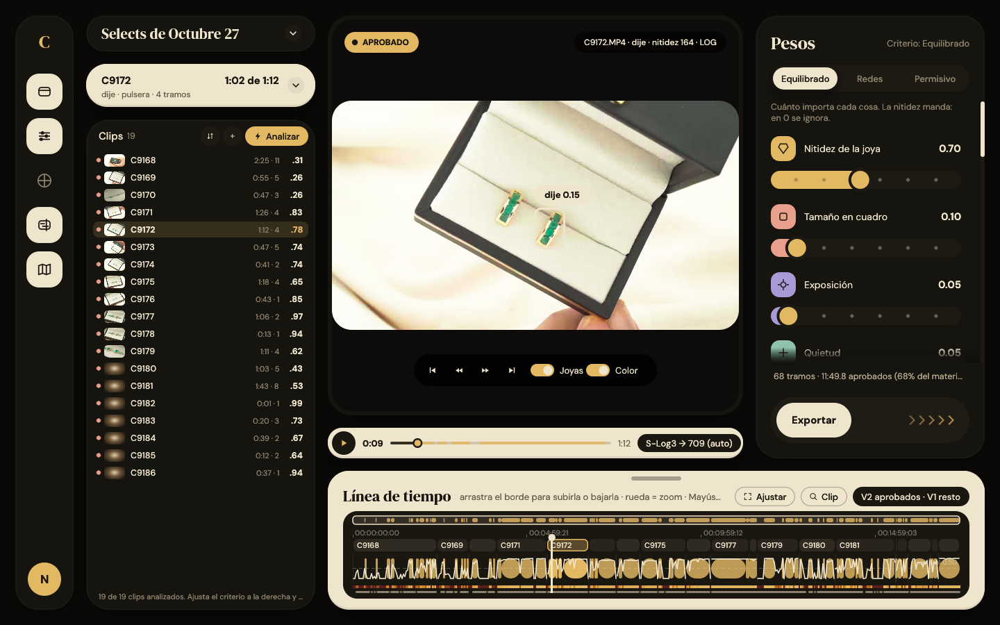
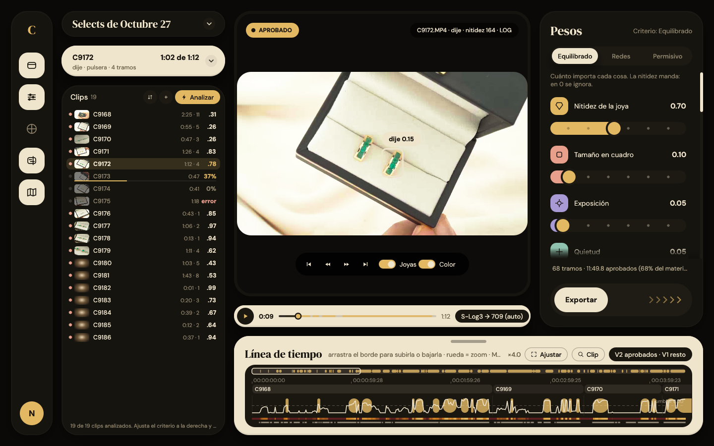

# La ventana de CAMCUTS (edición joyas)

CAMCUTS es la app de Napoleone Joyas que revisa el material de cámara, elige los tramos donde la joya está nítida y los exporta a DaVinci Resolve. Este documento cubre la ventana: `camcuts.exe`, crate `crates/camcuts-gui`, diseño "Marfil".

- **Parte 1** es la guía de uso, para el editor.
- **Parte 2** explica cómo está hecha, para quien toca el código.

La edición Bodas (`camcuts-bodas.exe`) comparte casi todo el código de la ventana. Ver [bodas.md](bodas.md).

Las decisiones de diseño y el contrato entre crates están en [INTERFACES.md](../INTERFACES.md). Aquí no se repiten: se enlazan.



---

# Parte 1 · Guía de uso

## El flujo en cuatro pasos

1. **Agrega el material.** En la tarjeta **Clips**, pulsa **+** y elige **+ Carpeta…** o **+ Archivos…**. Los resultados van solos a `<carpeta del material>\CAMCUTS`.
2. **Analiza.** Pulsa **Analizar** (la píldora dorada de la tarjeta Clips). Los clips ya analizados se saltan. Mientras dura, el botón dice **Detener**.
3. **Revisa.** Elige un clip en la lista y míralo en el visor. Ajusta el criterio en la columna **Pesos**: todo se recalcula al instante, sin volver a analizar.
4. **Exporta.** Pulsa **Exportar** (abajo en la columna Pesos) o **Ctrl+E**. La ruta del `.otio` queda copiada. En DaVinci: *File ▸ Import ▸ Timeline…* y pégala.

Los fps de la exportación deben coincidir con los de tu línea de tiempo de DaVinci (ver [Exportar](#exportar)).

## Los paneles

La ventana tiene un riel de iconos a la izquierda y cuatro zonas. Cada zona se oculta con su botón del riel o con su atajo.

| Zona | Atajo | Qué tiene |
|---|---|---|
| Riel | — | Logo, un botón por panel y, abajo, el círculo dorado **N**: el menú **Proyecto** |
| Columna izquierda (Material) | Ctrl+1 | Título, recibo del clip, Color y la lista de clips |
| Visor y transporte | — | El cuadro, sus controles y la barra de avance. Siempre visible |
| Columna derecha (Pesos) | Ctrl+2 | Criterio, pesos, tramos, filtros y exportar |
| Línea de tiempo | Ctrl+4 | Todo el material en una franja, con la curva de puntuación |
| Tarjeta Color | Ctrl+3 | Dentro de la columna izquierda |
| Mapa | Ctrl+5 | Franja fina con todo el material, sobre la línea de tiempo |

### Columna izquierda

- **Título.** "Selects de *<carpeta del material>*", el estado y la hora del último guardado. Un hilo dorado en el borde de abajo marca el avance del análisis. Está plegado por defecto.
- **Recibo del clip.** Nombre, tiempo aprobado ("1:02 de 1:12"), códec, resolución, fps y código de tiempo. El recuadro oscuro muestra las joyas del clip y la nitidez del instante. Está plegado por defecto; un clic lo despliega.
- **Joya de este clip.** Clic en el recuadro oscuro del recibo. Fija el nombre de la joya en todo el clip ("Automático" lo quita). Se guarda en `clip_types.json` y queda como ejemplo para entrenar.
- **Color** (Ctrl+3). Ver [Color](#el-color-del-visor).
- **Clips.** La lista. Ver abajo.

Si falta alto para la lista (menos de 200 px), el título y el recibo se pliegan solos y la tarjeta de color se encoge. Tu preferencia de plegado no cambia.

### La lista de clips

Cada fila tiene un punto de estado, una miniatura, el nombre, "duración · tramos" y la puntuación media.

| Punto | Significa |
|---|---|
| Oro | Analizado, con tramos aprobados |
| Marfil apagado | Analizado, sin tramos |
| Coral | Hay que reanalizarlo: cambió el color o el detector |
| Gris | Pendiente |

- **Clic** elige el clip y va a su primer tramo.
- **Ctrl+clic** o **Mayús+clic** elige varios (para darles color a la vez).
- Al pasar el ratón: ruta, códec, resolución, fps, estado y resumen.
- Mientras se analiza, en lugar de la puntuación sale el **avance del clip**: `37%` con una barra fina debajo, `0%` si está en cola y `error` en coral si falló.
- **Ordenar** (icono de flechas): por carpeta, clip, estado, puntuación, duración, con joya, aprobado o tramos. Un segundo clic invierte el orden.
- El pie muestra el estado. Al pasar el ratón, los totales del material.

El estado de cada clip (en la ayuda de la fila) es uno de estos: `Analizado`, `LOG · analizado`, `S-Log3 · analizado` (o el perfil elegido), `Reanalizar · color`, `Reanalizar · detector`, `Analizando…`, `Sin conexión` o `Pendiente`.

### El menú + (Material)

| Opción | Qué hace |
|---|---|
| + Carpeta… / + Archivos… | Agrega material |
| Quitar todo | Vacía el material |
| Subcarpetas | Recorre también las subcarpetas (por defecto, sí) |
| Segundo plano (seguir editando) | Ver [Segundo plano](#segundo-plano-y-clips-en-paralelo) |
| Zoom joyas diminutas | Segunda mirada a 1920 px en orejas, cuello y muñecas. Más lento |
| Detector: Propio · Clásico | Ver [Detector](#detector-propio-o-clásico) |

Las carpetas `CAMCUTS`, `CAMCUTS Bodas`, `cache` y `thumbs` nunca se recorren: son resultados, no material. Tampoco las copias `._` de macOS.

## El visor

- **Cajas de joya.** La joya principal lleva un trazo marfil y una píldora con **su** etiqueta y **su** confianza en ese cuadro. Las demás, un trazo fino y su texto. El interruptor **Joyas** las oculta.
- **APROBADO.** Píldora dorada arriba a la izquierda cuando el cabezal está dentro de un tramo aprobado.
- **Información.** Arriba a la derecha: clip, joyas a la vista, nitidez (p99 del Laplaciano) y "LOG" si el clip es LOG.
- **Controles.** Al inicio, −2 s, +2 s, siguiente tramo, **Joyas** y **Color**. Con clips horizontales van debajo del cuadro, siempre visibles. Con clips verticales aparecen al pasar el ratón por el visor. Si el visor es muy pequeño (menos de 380×260), se ocultan; siguen el teclado y el transporte.
- **Clic en el cuadro**: reproducir o pausar.
- **Transporte** (barra marfil de abajo): reproducir, tiempo, barra de avance con los tramos aprobados, duración y la píldora de color.
- Si no se puede decodificar el cuadro (clip sin conexión y sin vista previa, error de ffmpeg), el visor dice **"No se puede mostrar este cuadro"**. Nunca deja la imagen de otro clip.

La reproducción va a los fps del clip, con un tope de 30 cuadros por segundo. El visor decodifica a tamaño de análisis (lado largo 960 px).

### El color del visor

Con **Automático**, el visor aplica el perfil que dice la cámara:

- XML de Sony (`C0001M01.XML` junto al clip, o el que la cámara incrusta en el MP4);
- etiquetas HLG;
- Apple Log.

Un S-Log3 se ve convertido a Rec.709, no gris. Si los metadatos no dicen nada, solo se estira el contraste de los clips LOG.

La píldora de color del transporte dice lo que de verdad aplica el visor:

| Píldora | Significa |
|---|---|
| `S-Log3 → 709 (auto)` | Automático, con el perfil de la cámara |
| `LOG → contraste` | Automático, sin perfil, clip LOG |
| `Automático` | Automático, sin perfil, clip normal |
| `Sin conversión` | "Ninguna", o la cámara dice que ya está lista |
| `S-Log3 → 709` | Conversión elegida a mano |
| `LUT .cube` | Tu LUT |

Un clic en la píldora abre o cierra la tarjeta **Color**. En ella:

- el desplegable da una conversión al clip actual (Sony S-Log3/S-Gamut3.Cine, S-Log3/S-Gamut3, S-Log2, HLG, Panasonic V-Log, Canon C-Log3, Apple Log, ninguna, automático o una LUT `.cube`);
- **Selección (n)** y **Todos** dan esa conversión a los clips elegidos o a todos;
- **Detectar** lee el perfil de cámara de los clips elegidos (si hay más de uno) o de todos, y se lo asigna;
- **Ver con color** apaga o enciende la conversión en el visor y en las miniaturas.

**Importante:** el análisis sigue usando "Automático" tal cual, porque los umbrales de nitidez se calibraron con él. Si eliges una conversión a mano (o con Detectar), los clips ya analizados pasan a **Reanalizar · color**. Pulsa Analizar para rehacerlos.

### Vistas previas (proxies)

El visor busca al instante gracias a las vistas previas: `cache\proxies\<caché del clip>.mp4`, a tamaño de análisis, con GOP de 8 cuadros y sin cuadros B.

- El análisis las crea mientras analiza.
- Si un clip analizado no tiene la suya (por ejemplo, lo analizó la versión de Python), la ventana la crea en segundo plano, una a la vez y con prioridad baja. La barra de estado dice "Creando vistas previas para un visor fluido… 3/10" y luego "Vistas previas listas".
- Sin vista previa, el visor decodifica el original. Funciona, pero buscar es más lento.
- Las vistas previas sirven también con la unidad del material desconectada.

### Rotación

- Las vistas previas ya están derechas. Algunas conservan la marca de rotación de la cámara, así que en las de `…\cache\proxies\` la rotación automática de ffmpeg se apaga. Así un clip vertical no sale girado ni estirado.
- Los originales (por ejemplo, un iPhone en vertical) sí usan su marca de rotación. Una carpeta "Proxies" tuya no cuenta como vista previa de CAMCUTS.
- El cuadro se escala sin deformarse y lo que sobra se rellena de negro. Si un archivo declara mal su rotación, verás franjas negras, nunca una imagen aplastada.

## Detector Propio o Clásico

En el menú **+**, sección **Análisis**, el selector **Detector** tiene dos opciones:

| Detector | Qué es |
|---|---|
| **Propio** (por defecto) | Un YOLO11 entrenado con el material de la marca. Más preciso y más rápido |
| **Clásico** | YOLO-World, el detector general de siempre |

- La ayuda del selector explica lo mismo. La píldora **Analizar** dice qué detector usará.
- **Cambiar de detector no borra nada.** Los clips analizados con el otro pasan a **Reanalizar · detector** (punto coral). Analizar los rehace con el elegido.
- **Respaldo automático.** Con el Propio, si en un clip casi nunca da la joya nítida (tomas macro con poco foco), ese clip se analiza también con el Clásico y queda ese análisis. Vale para los dos detectores: no se repite.
- **GPU ocupada.** Con el Clásico y poca memoria de GPU libre (DaVinci abierto), analiza el Propio en su lugar (si está instalado), porque el Clásico grande no cabe. Esa caché vale para los dos.
- La elección se guarda en el proyecto.

Las reglas exactas (qué caché vale para qué detector, cuándo salta el respaldo) están en [INTERFACES.md](../INTERFACES.md), secciones "Detector propio", "Respaldo automático" y "Own detector by default".

## Criterio y filtros

Todo lo de la columna **Pesos** se recalcula al instante sobre lo ya analizado.

**Criterio** (arriba):

| Botón | Preset | Para qué |
|---|---|---|
| Equilibrado | `joyas` | El de siempre |
| Redes | `social` | Cortes cortos para redes |
| Permisivo | `todo` | Aprueba más |

Cambiar de criterio restablece sus valores, pero conserva los filtros de joyas y planos. **Restablecer criterio** vuelve a los valores del criterio actual.

**Pesos** ("Cuánto importa cada cosa. La nitidez manda: en 0 se ignora"):

| Peso | Rango |
|---|---|
| Nitidez de la joya | 0 – 1.5 |
| Tamaño en cuadro | 0 – 1 |
| Exposición | 0 – 1 |
| Quietud | 0 – 1 |
| Joya más nítida que el fondo | 0 – 1 |
| Sin barrido de movimiento | 0 – 1 |

**Tramos:**

| Ajuste | Rango |
|---|---|
| Puntuación mínima | 0.10 – 0.95 |
| Duración mínima del tramo | 0.25 – 10 s |
| Duración máxima del tramo | 1 – 120 s |
| Tramos máximos por clip | 1 – 99 |
| Tolerancia a caídas | 0 – 4 s |
| Consistencia (suavizado) | 0 – 4 s |

**Filtros** (ninguno marcado = todos):

- **Joyas:** anillo, dije, cadena, collar, arete, topo, candonga, pulsera, tobillera, rosario, piercing, joya.
- **Planos:** Producto, Modelo, Hablando.

Los valores de partida de cada criterio salen del núcleo con la calibración del editor (`models\calibration.json`, si existe).

## Exportar

En la columna Pesos, sección **Exportar a DaVinci**:

- **fps de tu línea de tiempo:** Auto (los más comunes entre los clips analizados), 23.976, 24, 25, 29.97, 30, 50, 59.94 o 60.
- **Modo:**

| Modo | Qué hace |
|---|---|
| V2 aprobados · V1 el resto (sin duplicar) | El clip entero: los aprobados en V2 y el resto en V1 |
| Solo los tramos aprobados | Solo los aprobados, uno tras otro |
| V1 clips completos con marcadores | El clip entero, con un marcador por tramo |

La píldora del modo en la línea de tiempo también cambia de modo con cada clic.

**Exportar** escribe en la carpeta de resultados:

- `CAMCUTS_<criterio>_<modo>.otio`, por ejemplo `CAMCUTS_Equilibrado_v1v2.otio`, con audio enlazado y un marcador por tramo (verde, amarillo o rojo según la puntuación);
- un `.csv` con el mismo nombre.

El aviso dice cuántos tramos y clips salieron, y cuántos clips sin analizar quedaron fuera. Si el CSV está abierto en Excel, la línea de tiempo se escribe igual y el aviso lo dice.

El análisis deja además sus propios `selects_<criterio>.otio` y `.csv` en la misma carpeta.

## Mapa y línea de tiempo



**Línea de tiempo** (Ctrl+4), abajo. Todo el material seguido, clip tras clip:

- regla con código de tiempo (a los fps de exportación);
- carril de clips, con el nombre si cabe; el actual en dorado;
- los tramos aprobados como píldoras doradas;
- la curva de puntuación y la línea discontinua del umbral;
- una franja de calor (rojo oscuro → ámbar → oro según la puntuación);
- una franja con la presencia de joya;
- si la línea de tiempo es alta, tres carriles con los tipos de joya más frecuentes del clip actual;
- el cabezal.

Controles:

- **Clic o arrastrar:** va a ese momento y elige el clip que cae ahí.
- **Rueda:** zoom alrededor del puntero (×1 a ×200).
- **Mayús+rueda:** desplazar.
- **Arrastrar el borde de arriba:** cambia el alto.
- **Ajustar:** ver todo el material. **Clip:** acercar al clip actual.

**Mapa** (Ctrl+5). Una franja fina sobre la línea de tiempo con todo el material y sus tramos aprobados. Con zoom, un recuadro marca lo que estás viendo; arrastra o haz clic en la franja para moverte. El mapa necesita alto: al encenderlo se muestra la línea de tiempo y sube al menos a 200 px.

## Proyectos `.camcuts`

El menú **Proyecto** es el círculo dorado **N**, abajo en el riel.

| Opción | Atajo |
|---|---|
| Nuevo proyecto | Ctrl+N |
| Abrir proyecto… | Ctrl+O |
| Guardar como… | Ctrl+Mayús+S |
| Cambiar carpeta de resultados… | — |
| Abrir carpeta de resultados | — |
| Abrir resultados existentes (sin material)… | — |

Un proyecto guarda el material, la carpeta de resultados, el criterio con sus pesos y filtros, el detector, el modo y los fps de exportación, el color y la joya de cada clip, y cómo dejaste la ventana (paneles, alto de la línea de tiempo, zoom del mapa, clip e instante).

- **Se guarda solo**, 1.5 s después de cada cambio. La etiqueta del menú dice "Proyecto: X · guardado 12:34:56".
- Un trabajo nuevo se guarda en la carpeta de resultados, con el nombre de la primera fuente (normalmente, la carpeta del material), en cuanto agregas material.
- **Abrir no guarda.** El archivo solo se reescribe cuando cambias algo.
- Al arrancar, CAMCUTS abre el último proyecto. También abre un `.camcuts` con doble clic, o con `camcuts.exe trabajo.camcuts`.
- `camcuts.exe <carpeta de resultados>` abre una carpeta de resultados sin material (hecha por Python o por Rust).
- Con un análisis en curso no se puede cambiar de proyecto: "Espera a que termine el análisis."
- Los proyectos son compatibles con la versión de Python, en los dos sentidos.
- Un proyecto de **CAMCUTS Bodas** se abre solo para mirar. Ver [Modo solo lectura](#modo-solo-lectura).

## Material sin conexión

Si la unidad del material no está conectada al abrir el proyecto:

- El proyecto **conserva las rutas** y no se reescribe hasta que cambies algo. No se pierde nada.
- La barra de estado lo dice en rojo: "Material sin conexión: Octubre 27. Conecta la unidad; el proyecto lo conserva."
- La carpeta de resultados automática sigue siendo la del material (`<material>\CAMCUTS`), aunque la unidad falte. Si está en esa misma unidad, tampoco está: la lista queda vacía hasta que la conectes.
- Si la carpeta de resultados está en otra unidad conectada (**Cambiar carpeta de resultados…**), los clips ya analizados **siguen en la lista**, desde la caché. Puedes revisar, ajustar el criterio y exportar. El visor usa las vistas previas; sin vista previa, dice "No se puede mostrar este cuadro".
- Los clips sin analizar de esa unidad no aparecen hasta que la conectes.

El estado **Sin conexión** de un clip es otra cosa: ffprobe no pudo leerlo (archivo dañado o sin pista de video).

## Atajos de teclado

Salen de `App::atajos` en `paneles.rs`. No actúan mientras escribes en un campo de texto.

| Tecla | Acción |
|---|---|
| Espacio | Reproducir o pausar |
| ← / → | −2 s / +2 s |
| N | Siguiente tramo aprobado (o el primero) |
| Inicio | Al principio del clip |
| ↑ / ↓ | Clip anterior / siguiente |
| Ctrl+1 | Mostrar u ocultar la columna izquierda (Material) |
| Ctrl+2 | Mostrar u ocultar la columna Pesos |
| Ctrl+3 | Mostrar u ocultar la tarjeta Color |
| Ctrl+4 | Mostrar u ocultar la línea de tiempo |
| Ctrl+5 | Mostrar u ocultar el mapa |
| Ctrl+N | Proyecto nuevo |
| Ctrl+O | Abrir proyecto |
| Ctrl+Mayús+S | Guardar como |
| Ctrl+E | Exportar |

Con el ratón: clic en el cuadro para reproducir o pausar; Ctrl+clic y Mayús+clic en la lista; rueda y Mayús+rueda en la línea de tiempo.

## Segundo plano y clips en paralelo

**Segundo plano (seguir editando)** está encendido por defecto. Pasa `--background` al análisis:

- el análisis y sus ffmpeg corren con prioridad "por debajo de lo normal", para que DaVinci siga fluido;
- se analizan menos clips a la vez.

Cuántos clips se analizan a la vez:

| Situación | Detector Propio | Detector Clásico |
|---|---|---|
| Segundo plano | Hasta 2 | 1 |
| Sin segundo plano | Según el equipo, hasta 4 | Según el equipo, como mucho 2 |
| Poca VRAM libre (modo ligero, menos de 4.5 GB) | No cambia | Analiza el Propio en su lugar, con las cifras del Propio. Sin el Propio instalado: YOLO-World mediano, 1 clip |

"Según el equipo" es un clip por cada 4 hilos de CPU, entre 1 y 4. Además, nunca se lanzan más clips de los que caben en la memoria libre de la GPU. Con el Propio, los clips en paralelo comparten los mismos modelos en la GPU, así que cada clip extra solo necesita la memoria de su ffmpeg.

- Con 2 clips o más a la vez, se empieza por los archivos más grandes. Con uno a la vez, se sigue el orden de la lista.
- La barra de estado muestra la línea **"equipo:"** con la GPU, el modo y los clips en paralelo. Si dice **GPU OCUPADA**, sale en rojo: la memoria no alcanzó y el análisis pasó a modo ligero.

Los números y las mediciones están en [INTERFACES.md](../INTERFACES.md): "Velocidad del análisis", "Poca VRAM con DaVinci abierto" y "Own detector by default".

---

# Parte 2 · Cómo está hecha

## Mapa del crate

`crates/camcuts-gui` es una librería (`camcuts_gui`, en `src/lib.rs`) y dos binarios. La librería existe para que las pruebas sin pantalla usen la misma lógica.

| Archivo | Qué hace |
|---|---|
| `main.rs` | Binario `camcuts.exe`: modo análisis (`--analizar`) o ventana |
| `main_bodas.rs` | Binario `camcuts-bodas.exe`: fija la edición Bodas y hace lo mismo |
| `lib.rs` | Declara los módulos y `Ventana`, el adaptador `eframe::App` |
| `app.rs` | `App`: estado y lógica, sin dibujo |
| `paneles.rs` | Dibujo de Marfil y atajos (`App::dibujar`, `App::atajos`) |
| `bodas_ui.rs`, `bodas_tema.rs` | Dibujo y tema "Salvia" de Bodas |
| `motor.rs` | Puente con `camcuts-core`: criterios, caché, puntuar, exportar, color |
| `video.rs` | Hilos del visor y de las miniaturas (ffmpeg) |
| `analisis.rs` | Proceso hijo del análisis, Job Object, proxies, sondeo, perfiles |
| `datos.rs` | Buscar clips, ffprobe, tiempos, rutas |
| `proyecto.rs` | Archivos `.camcuts` y preferencias |
| `widgets.rs` | Controles propios (tarjetas, píldoras, barras) |
| `tema.rs` | Colores, medidas y fuentes de Marfil (de `design/Marfil.html`) |
| `iconos.rs` | Iconos vectoriales |

Todo lo que es "cálculo de CAMCUTS" (criterios, puntuación, tramos, exportar, convertir color, detectar perfil) vive en `camcuts-core`. `motor.rs` solo lo traduce a una vista sencilla (`Entrada`, `MuestraVista`, `JoyaVista`, `Tramo`).

Las fuentes DM Serif Display y DM Sans van incrustadas desde `crates/camcuts-gui/assets/fonts` (licencia OFL). El renderizador es wgpu; no hay OpenGL.

## El ciclo de cada cuadro

`Ventana::ui` llama a `App::dibujar` (`paneles.rs`). En Bodas, `App::dibujar` pasa a `App::dibujar_bodas`.

1. `App::antes_de_dibujar`:
   - `atender_mensajes`: lee el canal de los hilos de fondo;
   - `recoger_cuadro` y `recoger_miniaturas`: suben las texturas nuevas;
   - `puntuar`, si algo del criterio cambió (`puntuar_pendiente`);
   - autoguardado si pasaron 1.5 s desde el último cambio (`sucio`);
   - pide repintar cada 250 ms mientras reproduce o analiza.
2. `App::atender_cierre`: ver [Cancelar y salir](#cancelar-y-salir).
3. `App::atajos`.
4. La distribución: rectángulos calculados a mano, con animaciones de 0.25 s al ocultar paneles.

La distribución absoluta viene de la maqueta: cada panel se desliza y se desvanece, y la línea de tiempo cambia de alto arrastrando su borde.

## El estado de `App`

`App` (en `app.rs`) es todo el estado de la ventana, compartido por las dos ediciones.

| Grupo | Campos | Notas |
|---|---|---|
| Material | `fuentes`, `recursivo`, `out`, `out_auto`, `segundo_plano`, `zoom_joyas`, `detector` | `out_auto`: la carpeta de resultados sale del material |
| Clips | `clips`, `actual`, `seleccion`, `ancla`, `orden`, `tipos`, `colores` | `seleccion` y `ancla` guardan **claves**, no filas: la lista se reordena |
| Criterio | `criterio` (`motor::Criterio`), `fps`, `modo` | |
| Visor | `t`, `reproduciendo`, `ver_joyas`, `ver_color`, `tex_visor`, `tam_cuadro`, `sin_cuadro` | |
| Línea de tiempo | `alto_tiempo`, `zoom_mapa`, `t0_mapa`, `paneles`, `titulo_plegado`, `recibo_plegado` | |
| Estado visible | `estado`, `estado_color`, `progreso`, `avance_clips`, `resumen`, `totales`, `etiqueta_proyecto`, `ruta_proyecto`, `solo_lectura`, `aviso` | |
| Trabajos de fondo | `visor`, `miniaturas`, `tx`/`rx`, `analisis`, `proxies`, `sondeando`, `metas_sesion` | Todos avisan por un canal `Mensaje` |
| Guardado | `cargando`, `sucio`, `puntuar_pendiente`, `persistir` | `persistir = false` en las pruebas |
| Bodas | `modo_claro`, `cache_bodas`, `revision_clips` | |

Un `Clip` tiene su ruta, su clave (la ruta en minúsculas, como en los JSON de Python), su `Entrada` de la caché si está analizado, sus metadatos de ffprobe y lo calculado con el criterio (`curva`, `tramos`, `aprobado`).

**`App::cargar_clips`** arma la lista:

1. lee `clips_meta.json` y le suma `metas_sesion`;
2. lee `clip_types.json` y le suma los tipos del proyecto;
3. lee las cachés con `motor::cargar_cache`. Ese paso descarta las cachés de la otra edición (`edicion::cache_vigente`), elige la más reciente si un clip tiene dos y aplica `refine_jewels`, `stabilize_labels` y el tipo forzado;
4. reúne los clips del material conectado (`datos::reunir_clips`) y, para el material sin conexión, los de la caché que caen dentro (`datos::dentro_de`, por componentes enteros);
5. quita duplicados, ordena, puntúa (`App::puntuar`) y escribe el estado;
6. lanza el sondeo de metadatos que faltan y los proxies que faltan.

`revision_clips` sube en cada recarga. Bodas la usa para rehacer sus carriles de momentos.

## Preferencias y la migración `detector_v`

Las preferencias son el estado del proyecto (`App::estado_json`) más `last_project`. Viven en `%APPDATA%\CAMCUTS-rs\settings.json`; Bodas usa `%APPDATA%\CAMCUTS-Bodas\settings.json` (`proyecto::ruta_preferencias`).

Al arrancar sin argumentos, `App::cargar_preferencias` abre `last_project` si existe. Si no, aplica las preferencias con `App::aplicar_estado`.

**Migración del detector.** Hasta el 2026-11-05 el detector por defecto era YOLO-World, y casi todos los estados guardaban `"detector": "world"` sin que nadie lo eligiera. Ahora el predeterminado es el propio. Para distinguir:

- `App::estado_json` escribe `detector` y, a su lado, `detector_v: 2` (`CLAVE_DETECTOR_V`, `DETECTOR_V`). Solo en joyas; Bodas no escribe ninguna de las dos.
- `App::aplicar_estado` respeta el `detector` guardado solo si `detector_v >= 2`. Un estado sin `detector_v` (de antes, o de Python) carga **Propio**.
- Los clips que se analizaron con el clásico salen entonces "Reanalizar · detector".

La prueba `detector_en_proyecto_estado_y_analisis` (en `app.rs`) cubre los tres casos.

## El análisis: un proceso hijo

El análisis corre en un proceso aparte, como en Python. Si falla, la ventana no cae.

### Lanzar

`App::analizar`:

1. Reúne los clips del material. Sin clips, avisa.
2. `analisis::ruta_cli` elige el ejecutable: `CAMCUTS_CLI` si está definida (otra CLI con las opciones de Python), si no el propio exe con `--analizar`.
3. Escribe `<resultados>\clips.txt` (una ruta por línea) y `colores.json`.
4. Arma los argumentos:

   ```text
   camcuts.exe --analizar --lista <out>\clips.txt --out <out> --no-sheet
               --preset <criterio> --colores <out>\colores.json
               [--background] [--zoom] [--detector propio|world]
   ```

   `--detector` lo añade `App::args_detector`: solo en joyas y solo para el `--analizar` propio, nunca para una CLI externa. Va siempre, también `world`, para que una variable `CAMCUTS_DETECTOR` heredada no cambie lo elegido.
5. Guarda las preferencias y para el trabajo de proxies.
6. `Analisis::lanzar` arranca el hijo.

`Analisis::lanzar`:

- stdout y stderr por tuberías, stdin nulo, sin consola (`CREATE_NO_WINDOW`);
- variables `PYTHONIOENCODING=utf-8` y `CAMCUTS_PROGRESO=1`;
- **Job Object**: nada más nacer, el hijo entra en un `Trabajo` con `JOB_OBJECT_LIMIT_KILL_ON_JOB_CLOSE`. Sus ffmpeg heredan el trabajo. Cuando se cierra el último handle (al soltar `Analisis`, o si la ventana muere de golpe o desde el Administrador de tareas), Windows mata todo el árbol. Si Windows no deja crear el trabajo, se escribe un aviso en stderr y el análisis sigue;
- un hilo lee stdout y otro stderr, línea a línea, y mandan `Mensaje::Linea`;
- cuando termina stdout, el hilo espera al proceso (`try_wait` cada 100 ms, sin bloquear el candado que necesita Detener) y manda `Mensaje::Fin(código)`.

### El modo `--analizar`

`main.rs` mira el primer argumento. Si es `--analizar`, llama a `analisis::ejecutar_analisis` y sale con su código; no abre ventana. `main_bodas.rs` hace lo mismo después de fijar la edición.

`analisis::ejecutar_analisis`:

1. Lee las opciones con el mismo parser que la CLI del núcleo (`camcuts_core::cli::Args`).
2. Arma `InferConfig`: `models\` y `runtime\` junto al exe si existen, si no las del workspace; el detector de `Args::detector_kind` (en Bodas, siempre YOLO-World).
3. `camcuts_infer::motor_listo` prepara el motor (DirectML por defecto; si CUDA se eligió solo y falla, relanza el mismo proceso con DirectML).
4. Crea dos fábricas de detectores:
   - `camcuts_infer::fabrica(cfg)`: con el propio, todos los hilos comparten un detector (`Compartido`); con YOLO-World, uno por hilo;
   - la del respaldo: YOLO-World con `propio_si_no_cabe: false`.
5. `camcuts_core::cli::run_con_respaldo`. Devuelve 0 o 1.

### Leer la salida

`App::atender_mensajes` reconoce tres tipos de línea:

| Línea | Qué hace la ventana |
|---|---|
| `progreso<TAB>N<TAB>ruta` | Guarda el avance del clip. No relee la lista |
| `[3/10] C9172.MP4: …` | Actualiza `progreso`, la barra de estado y **relee la lista** |
| `equipo: …` | La copia en la barra de estado (en rojo si dice `OCUPADA`) |

Las demás líneas (por ejemplo `aviso:` o `error:` en stderr) no se muestran.

`Mensaje::Fin(0)` deja "Análisis terminado. Ajusta el criterio a la derecha y exporta." Otro código deja "El análisis se detuvo (código N)." en rojo. En los dos casos se vacía `avance_clips` y se relee la lista.

### Avance por clip (`CAMCUTS_PROGRESO`)

Con la variable `CAMCUTS_PROGRESO` (`cli::VARIABLE_PROGRESO`), la CLI escribe por cada clip:

- `progreso<TAB>0<TAB>ruta` al empezar;
- una línea por cada punto entero mientras muestrea, con tope en 99;
- `100` al terminar, o `error` si falla o es un RAW sin proxy.

Sin la variable, la salida de la CLI no cambia. El formato exacto está en [INTERFACES.md](../INTERFACES.md), "Avance por clip y orden de los clips".

En la ventana:

- `analisis::avance` interpreta la línea;
- `App::avance_clips` guarda clave → `Some(0..100)` o `None` (falló);
- `App::avance_de` decide qué enseña la fila: el porcentaje, `0%` para los clips sin caché que esperan, `error`, o lo de siempre si el clip ya terminó y su caché está leída;
- la barra de estado: "Analizando… 3 de 10 clips listos · C9243.MP4 37%".

Un mapa de avance con datos cuenta como análisis en curso aunque `analisis` sea `None`. Así las pruebas sin pantalla lo simulan.

### Cancelar y salir

- **Detener** (`App::detener` → `Analisis::detener`): `taskkill /T /F /PID <hijo>`, que mata el árbol entero. Si `taskkill` no arranca, `Child::kill`. Después llega `Mensaje::Fin` con un código distinto de 0.
- **Cerrar la ventana con un análisis en curso** (`App::atender_cierre`): se cancela el cierre (`ViewportCommand::CancelClose`) y sale el aviso "Hay un análisis en curso. ¿Detenerlo y salir?". **Detener y salir** llama a `App::al_cerrar` y cierra; **Seguir** vuelve.
- **`App::al_cerrar`** (también desde `Ventana::on_exit`): detiene el análisis y los proxies, para el visor y guarda proyecto y preferencias.
- **Cierre brusco** (cuelgue, Administrador de tareas): no pasa por nada de lo anterior. Lo cubre el Job Object.

La prueba `trabajo_mata_al_hijo_al_cerrarse` (en `analisis.rs`) lo comprueba con un `cmd` que lanza un `ping`.

## El trabajo de proxies

`App::lanzar_proxies` se llama al final de cada `cargar_clips`. Busca los clips analizados cuyo proxy no existe y cuyo video (el original o su `decode_path`) sí. Si no hay análisis en curso ni otro trabajo vivo, lanza `analisis::TrabajoProxies`.

`TrabajoProxies::lanzar`:

- un hilo, un clip a la vez;
- cada ffmpeg con prioridad baja y sin consola, dentro de su propio Job Object;
- `ffmpeg -hwaccel auto -i <video> -vf scale=<ancho>:<alto>:flags=area` con `camcuts_core::sampler::PROXY_ARGS` (libx264 `veryfast`, CRF 20, GOP 8, sin B) a `<proxy>.part.mp4`, que se renombra a `.mp4` solo si salió bien y no está vacío;
- el tamaño es el de análisis (`analisis::medida_analisis`: lado largo 960, medidas pares);
- avisa con `Mensaje::Proxy("3/10")` y al final `Mensaje::Proxy("done")`.

`TrabajoProxies::detener` pone la bandera `parar` y mata el ffmpeg actual. El ffmpeg se lanza con el candado tomado y tras volver a mirar la bandera: así `detener` o llega antes (y no se lanza nada) o encuentra el proceso guardado y lo mata.

`App::analizar` para este trabajo: el análisis necesita la GPU y hace sus propios proxies. El trabajo de la ventana no rehace un proxy que ya existe; el análisis sí rehace los proxies viejos (CRF 28) al volver a analizar un clip (`sampler::proxy_vigente`).

## El visor

### `video.rs`

`Visor::nuevo` arranca el hilo `visor`. La interfaz manda pedidos con `Visor::pedir`:

| Pedido | Qué hace el hilo |
|---|---|
| `Buscar { fuente, t, ancho, alto, grado }` | Un ffmpeg que entrega **un** cuadro RGB desde `t` |
| `Reproducir { …, fps }` | Un ffmpeg que entrega cuadros seguidos, publicados a tiempo real |
| `Parar` | Mata la reproducción; el último cuadro queda |

- El hilo atiende solo el pedido más reciente: arrastrar la barra no acumula búsquedas.
- Comando: `ffmpeg -ss t -i <fuente> -vf scale=…:force_original_aspect_ratio=decrease,pad=…:black -f rawvideo -pix_fmt rgb24 pipe:1`, más `-noautorotate` si la fuente está en `…\cache\proxies\` (`es_proxy`).
- La reproducción limita los fps a 1–30 y duerme hasta la hora de cada cuadro.
- El hilo publica en `Salida`: o un `Cuadro` (con número de serie) o `sin_cuadro` con el número del pedido fallido. Nunca los dos.
- `Visor::pedir` sube `Salida::pedido` y marca `reproduciendo` en el acto. El hilo solo lo vuelve a `false` si no llegó otro pedido después. Antes, un repintado entre el pedido y el arranque de ffmpeg lo borraba y Espacio no pausaba.

En `App`:

- `App::buscar` acota `t`, elige la fuente (`App::fuente`: proxy si existe, si no `decode_path`, si no el original) y la medida de análisis.
- `App::recoger_cuadro` sube la textura `visor`. Si llega un fallo, quita la textura: la anterior es de otro clip y encima se dibujarían las cajas del nuevo.

`Miniaturas` es otro hilo: un ffmpeg a la vez, con prioridad baja, 156×108 recortado al centro. `App::recoger_miniaturas` pide una por clip analizado (o ya sondeado), en la mitad de su primer tramo o a un tercio del clip.

### `motor.rs`: `conversion_visor` y `graduador`

- `motor::conversion_visor(spec, ruta)`: con `"auto"`, el perfil de `camcuts_core::color::detect_profile` si da uno distinto de `auto` y `cube`; si no, el elegido.
- `motor::graduador(spec, log, ruta)` prepara la función que gradúa un cuadro en su sitio:
  - `none` → nada;
  - `auto` sin perfil y clip no LOG → nada;
  - `auto` sin perfil y clip LOG → estirar contraste;
  - lo demás → `color::make_converter`, con la decodificación de ffmpeg para ese clip (`color::decoding_for(ruta, "ffmpeg")`). El visor decodifica con ffmpeg; los valores por defecto de OpenCV suponían rango limitado y un S-Log3 de rango completo salía más plano.
- El núcleo trabaja en BGR; el graduador convierte RGB ↔ BGR.
- `video::CacheGrado` guarda el graduador por `Grado` (conversión, LOG, ruta): leer una LUT no se repite en cada cuadro.
- `motor::texto_pildora_color` da el texto de la píldora. `App::texto_color_actual` lo guarda por clip en `color_visor`, porque leer el XML de Sony en cada cuadro sería caro.

Solo el visor usa el perfil. El análisis sigue con `"auto"` tal cual. Ver [INTERFACES.md](../INTERFACES.md), "Viewer: colour and preview compression".

Prueba opcional con material real: `video::pruebas::cuadro_real_con_color_automatico`, con `CAMCUTS_VISOR_CLIP`, `CAMCUTS_VISOR_FUENTE` y `CAMCUTS_VISOR_PNG`.

## Proyecto, metas y `clip_types.json`

### El archivo `.camcuts`

Formato `camcuts-project`, versión 1, compatible con `camcuts/project.py`.

`proyecto::guardar`:

- añade `format`, `version`, `app` (`CAMCUTS` o `CAMCUTS Bodas`) y `saved`;
- guarda `sources` y `results_dir` como `{"abs": …, "rel": …}`, relativas a la carpeta del proyecto;
- escribe a `<proyecto>.tmp` y lo renombra: un corte a mitad nunca deja el proyecto roto;
- JSON con sangría de un espacio y sin escapar acentos, como Python.

`proyecto::abrir` comprueba `format`, quita el BOM y resuelve cada ruta: la absoluta si existe, si no la relativa si existe, si no la absoluta.

Claves que escribe `App::estado_json`:

| Clave | Contenido |
|---|---|
| `sources`, `out`, `results_dir`, `out_auto`, `recursive` | Material y resultados |
| `criterion`, `thr`, `min`, `max`, `per`, `gap`, `smooth`, `weights` | Criterio |
| `joyas` (`momentos` en Bodas), `tipos` | Filtros de tipo y de plano |
| `fps`, `export_mode` | Exportación |
| `background`, `zoom` | Opciones del análisis |
| `detector`, `detector_v` | Solo joyas |
| `clip_types`, `colors` | Tipo y color por clip |
| `ui` | `current`, `t`, `map_zoom`, `map_t0`, y extras de esta ventana que Python ignora: `paneles`, `alto_tiempo`, `titulo_plegado`, `recibo_plegado`, `modo_claro` |
| `analysis` | Clips totales, analizados y hasta 2000 pendientes |

`App::aplicar_estado` valida cada clave contra las listas de la edición, conserva las fuentes que no existen, recalcula `out` si `out_auto`, acepta el `all_clips: false` antiguo como modo `aprobados`, acota `alto_tiempo` a 120–520 y vuelve al clip y al instante guardados. Termina con `sucio = None`: abrir no marca cambios.

### Autoguardado

- `App::marcar_sucio` anota la hora del cambio. `antes_de_dibujar` guarda 1.5 s después.
- `App::guardar_preferencias` → `App::guardar_proyecto(None)` + `proyecto::guardar_preferencias`.
- `guardar_proyecto(None)` escribe en `ruta_proyecto` o, en un trabajo nuevo con material, en `proyecto::ruta_por_defecto` (`<resultados>\<carpeta del material>.camcuts`).
- `App::antes_de_cambiar_de_proyecto` impide cambiar de proyecto con un análisis en curso y guarda lo pendiente antes de abrir otro.

### Archivos de la carpeta de resultados

| Archivo | Quién lo escribe | Quién lo lee |
|---|---|---|
| `cache\*.json` | El análisis (un JSON por clip) | `motor::cargar_cache` |
| `cache\proxies\*.mp4` | El análisis y `TrabajoProxies` | El visor y las miniaturas |
| `clips_meta.json` | `analisis::sondear` (ffprobe en un hilo) | `App::cargar_clips` |
| `clip_types.json` | `App::poner_tipo` y `App::aplicar_estado` | `App::cargar_clips` y la CLI al puntuar |
| `colores.json` | `App::aplicar_color`, Detectar y `App::analizar` | El análisis (`--colores`) y `App::abrir_resultados` |
| `clips.txt` | `App::analizar` | El análisis (`--lista`) |
| `CAMCUTS_<criterio>_<modo>.otio/.csv` | `App::exportar` | DaVinci |
| `selects_<criterio>.otio/.csv`, `errores.txt`, `necesitan_proxy.txt` | La CLI | El editor |

**Metas.** `clips_meta.json` guarda, por clave, `codec`, `container`, `res`, `fps`, `duration` y `error`. `datos::sondear_meta` intercambia ancho y alto si la pista dice rotación de 90° o 270°. Un clip que no existe sale con `error: true` y la lista dice "Sin conexión". Si la carpeta no deja escribir, lo sondeado se queda en `metas_sesion`: sin eso cada recarga volvía a sondear sin fin. Se avisa una sola vez, en rojo.

**`clip_types.json`.** Un objeto clave → tipo ("anillo" en joyas, un momento en Bodas). `App::poner_tipo` lo escribe y relee la lista; `motor::cargar_cache` lo aplica con `scoring::force_type`. Al abrir un proyecto, sus `clip_types` se escriben en la carpeta de resultados, porque la CLI los lee de ahí.

## Modo solo lectura

Un proyecto de la otra edición (joyas en Bodas o Bodas en joyas) se abre para mirar. Lo decide el campo `app` (`proyecto::edicion_de`; sin campo es de joyas).

En `App::abrir_proyecto_al_arrancar`:

- `solo_lectura = true` y sale el aviso "Proyecto de otra edición";
- si el proyecto tiene material, la carpeta de resultados pasa a automática: esta edición trabaja en la suya y Analizar nunca reescribe las cachés de la otra;
- los `clip_types` del proyecto no se escriben ("votos" no vale en joyas).

Mientras dure:

- el autoguardado no escribe; la etiqueta dice "· de CAMCUTS Bodas, solo lectura (los cambios no se guardan; usa Guardar como)";
- **Guardar como** escribe una copia de esta edición y quita el solo lectura;
- **Nuevo proyecto** y **Abrir resultados existentes** también lo quitan.

Aparte, el autoguardado nunca pisa un proyecto de la otra edición que ya esté en la ruta por defecto (`proyecto::app_ajena`). Y las cachés de la otra edición no se cargan: sus clips salen pendientes y Analizar los rehace.

Ver [INTERFACES.md](../INTERFACES.md), "Edición Bodas (añadido)".

## Pruebas

### Pruebas de la librería

```powershell
cargo test -p camcuts-gui --lib
```

Cubren, entre otras: el ancla de selección, el material sin conexión, las fuentes por componentes, la carpeta automática por edición, el proyecto de la otra edición, el detector y su migración, las metas sin poder escribir, la píldora de color, el cuadro fallido, el porcentaje por clip, el mapa, el Job Object y la lectura de las líneas del análisis.

Algunas lanzan ffmpeg, ffprobe o `cmd`. Ninguna abre ventanas. `pildora_con_la_conversion_del_visor` lee un clip de `D:\` si existe, solo para leer.

### Capturas sin pantalla

`tests/capturas.rs` (joyas) y `tests/capturas_bodas.rs` (Bodas) dibujan la ventana con `egui_kittest` sobre wgpu, en una textura fuera de pantalla, y guardan PNG en `design/snapshots/`. Nunca abren una ventana. Usan la GPU (wgpu) y ffmpeg: sigue [GPU_TURNOS.md](../GPU_TURNOS.md).

Sin su variable, cada prueba se salta (y pasa).

**Joyas**, variable `CAMCUTS_BENCH`: una carpeta de resultados hecha por Python, por ejemplo una copia de `camcuts_next\bench_oct27`. La prueba exige al menos 19 clips, todos analizados con YOLO-World, y un título con "Octubre 27"; usa los clips C9169, C9172 a C9175, C9177 y C9181.

```powershell
$env:CAMCUTS_BENCH = "C:\ruta\a\copia\bench_oct27"
cargo test -p camcuts-gui --test capturas -- --nocapture
```

Deja `marfil_principal`, `marfil_linea_alta`, `marfil_recibo`, `marfil_1280x720`, `marfil_1920x1080`, `marfil_foco`, `marfil_detector` y `marfil_avance_y_mapa`.

**Bodas**, variable `CAMCUTS_BODAS_BENCH`: una carpeta analizada con `camcuts-bodas.exe` (con momentos). Opcionales: `CAMCUTS_BODAS_CLIP` (clip principal, por defecto `C9058`) y `CAMCUTS_BODAS_VERTICAL` (por defecto `IMG_414`).

```powershell
$env:CAMCUTS_BODAS_BENCH = "C:\Users\Usuario\Tools\camcuts_rs\bench_bodas"
cargo test -p camcuts-gui --test capturas_bodas -- --nocapture
```

Deja `bodas_principal`, `bodas_oscuro`, `bodas_vertical`, `bodas_1920x1080`, `bodas_1280x720` y `bodas_foco`.

Las carpetas `bench_*` no van en el repositorio (`.gitignore`): tienen material de la empresa. Cada equipo usa su copia local.

`design/Marfil.html` es la maqueta HTML de la que salen los colores y medidas de `tema.rs`.

---

## Discrepancias encontradas

En todos los casos manda el código.

1. **INTERFACES.md, "Detector propio (añadido)", no está al día.** Dice que YOLO-World es el predeterminado, que la CLI sin `--detector` usa `world`, que un proyecto sin `detector` carga `world` y que el selector dice "Clásico | Propio (beta)". El código: `DetectorKind::default()` es `Propio`; `App::aplicar_estado` carga Propio si falta `detector_v`; el selector es "Propio | Clásico" sin "(beta)". La sección posterior "Own detector by default" ya lo dice; la primera no se corrigió.
2. **INTERFACES.md, misma sección, clips en paralelo.** Dice "`--background` = 1 unless `--workers`". Con el detector propio, `hardware::parallel_clips` da `BACKGROUND_WORKERS_PROPIO` = 2 en segundo plano, y el modo ligero no lo limita. Solo con YOLO-World sigue siendo 1.
3. **INTERFACES.md, "Avance por clip y orden de los clips".** Dice que "Segundo plano", el predeterminado de la ventana, analiza un clip a la vez y por eso sigue el orden de la lista. Con el detector propio, que ahora es el predeterminado, "Segundo plano" analiza hasta 2 clips a la vez (si el equipo y la VRAM lo permiten), y entonces `cli::analizar_lote` empieza por los archivos más grandes. El orden de la lista se conserva cuando sale un solo clip a la vez: el clásico en segundo plano o en modo ligero, o poca VRAM.
4. **Comentario de `analisis.rs` (`Analisis::lanzar`).** Dice que stderr "también va a la barra de estado (avisos del análisis)". `App::atender_mensajes` solo muestra las líneas `progreso`, `[i/n]` y `equipo:`; los `aviso:` y `error:` de stderr no se ven en la ventana.
5. **Comentario de `tests/capturas.rs`, paso 7.** Habla del selector en "Propio (beta)". El selector dice "Propio".
